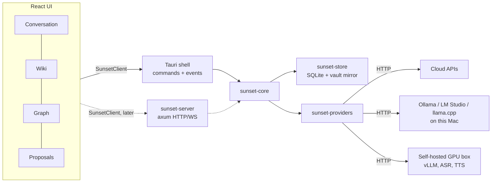

# Architecture Direction (Proposed)

**Status:** Proposed, 2026-11-08. Not yet confirmed. Change it freely; record the decision here when you do.

**Relationship to `docs/initial/initial.md`:** The initial spec describes the product and evaluates
technologies. It assumes a web app with a Python/FastAPI backend and PostgreSQL. This document
adapts that spec to the direction chosen on 2026-11-08: **a local-first macOS desktop app built with
Tauri, with an optional server later.** Where the two documents disagree on *technology*, this one
wins. Where they disagree on *product behavior*, the initial spec wins.

---

## 1. Guiding decisions

| # | Decision | Why |
|---|---|---|
| D1 | **Local-first desktop app first** (macOS, Tauri v2). No server in v1. | The core value is the app itself. A server adds auth, hosting and sync before the learning loop is proven. |
| D2 | **Two tiers inside one repo, split by Rust crates, not by processes.** All business logic lives in a transport-agnostic `core` crate. The Tauri shell is a thin adapter. A future `server` crate wraps the same core over HTTP/WebSocket. | Gives the web-app path later without paying the client/server cost now. |
| D3 | **Bring your own model. Bundle no models.** Every AI capability (chat LLM, embeddings, speech-to-text, text-to-speech, realtime voice, document parsing) is reached over the network through a provider adapter. A local Ollama or a self-hosted GPU box is the same kind of thing as a cloud API. | The model landscape is the biggest uncertainty. Keeping models out of the binary keeps the app small and lets us swap models without rebuilding. |
| D4 | **SQLite is the source of truth on device.** Plain Markdown is a mirror for user ownership. | Single file, zero setup, fast, easy to back up. Personal-scale data does not need PostgreSQL. |
| D5 | **The AI never writes the database directly.** It produces typed *proposals*; the core validates, applies policy (auto-save vs approval), and commits revisions. | Product requirement: reviewable, reversible capture (initial spec Part II §4.2, §7.4). |
| D6 | **Text first, voice second.** Build the full learning loop with typed input before touching audio. | Voice is the riskiest and most provider-dependent part. The knowledge loop must not depend on it. |

---

## 2. Layout

```text
project-sunset/
├── Cargo.toml                 # Rust workspace
├── package.json               # pnpm workspace root
├── crates/
│   ├── sunset-core/           # Domain types, knowledge pipeline, proposals, revisions, job runner,
│   │                          # event bus. No Tauri, no HTTP server, no UI code.
│   ├── sunset-store/          # SQLite (sqlx) persistence, migrations, FTS + vector search,
│   │                          # Markdown vault mirror.
│   ├── sunset-providers/      # AI provider traits + adapters (OpenAI-compatible, Anthropic, ...),
│   │                          # capability probing, role routing.
│   └── sunset-server/         # LATER. axum HTTP/WS wrapper around sunset-core for a web client.
├── apps/
│   └── desktop/               # Tauri v2 app
│       ├── src-tauri/         # Thin Rust shell: commands + events that call sunset-core
│       └── src/               # React + TypeScript UI (Vite)
├── packages/
│   └── bindings/              # TS types generated from Rust (specta / ts-rs). Never hand-edited.
└── docs/
```

The UI talks to the backend through one TypeScript interface (`SunsetClient`). The desktop app
implements it with Tauri `invoke` + events. A future web app implements it with `fetch` +
WebSocket against `sunset-server`. UI components never call Tauri APIs directly.



---

## 3. Data storage

**On device:** one SQLite file per knowledge library in the app data directory
(`~/Library/Application Support/<bundle-id>/`), plus a `files/` folder for uploads and artifacts.

- **Access:** `sqlx` with SQLite and versioned migrations. `sqlx` also supports PostgreSQL, which
  keeps the door open for `sunset-server`.
- **Schema:** use the canonical tables from the initial spec Part II §7.2: `sessions`, `turns`,
  `concepts`, `article_revisions`, `relations`, `learning_observations`, `sources`, `source_spans`,
  `claims`, `visual_artifacts`, `proposals`, `commits`, `jobs`. Desktop v1 has one local user, but
  keep a `user_id`/`library_id` column so the server can reuse the schema.
- **IDs:** UUIDv7 everywhere (sortable, generated offline, safe to merge later).
- **History:** `commits` is append-only. Undo is a compensating commit. This log is also the future
  sync unit.
- **Lexical search:** SQLite FTS5. Use the `trigram` tokenizer (or a second index) so Cantonese and
  other CJK text, which has no spaces, is searchable.
- **Semantic search:** store embeddings with their model name and dimension. Start with brute-force
  cosine in Rust (a personal library is thousands of chunks, not millions). Move to `sqlite-vec` only
  when measurement says so.
- **Markdown vault mirror:** after each commit, write `vault/<slug>.md` with YAML frontmatter and
  `[[WikiLinks]]`. Private learning observations go to `vault/.private_overlay/` and are excluded
  from any export. The mirror is one-way (DB → files) in v1.
- **Secrets:** provider API keys live in the macOS Keychain (`keyring` crate). Never in SQLite,
  config files or the webview.

**Cloud later, in this order:** (1) manual export/backup of the vault + DB snapshot; (2) folder
sync (iCloud Drive / any synced folder) of exports; (3) `sunset-server` with commit-log replication
for multi-device and web access. Do not design (3) now beyond UUIDv7 IDs and the append-only log.

---

## 4. Connecting to AI models

### 4.1 Separate interfaces per capability

Do not model everything as one `generate()` call (initial spec Part II §8.1). In `sunset-providers`:

```rust
// Illustrative. Real signatures will settle during Phase 0.
#[async_trait]
pub trait ChatModel: Send + Sync {
    async fn complete(&self, req: ChatRequest) -> Result<ChatResponse>;
    async fn stream(&self, req: ChatRequest) -> Result<BoxStream<'static, Result<ChatDelta>>>;
    fn capabilities(&self) -> &ChatCapabilities; // tools, json_schema, vision, context_window
}

#[async_trait]
pub trait Embedder: Send + Sync {
    async fn embed(&self, texts: &[String]) -> Result<Vec<Vec<f32>>>;
    fn model_id(&self) -> &str;
    fn dimension(&self) -> usize;
}

// Later: SpeechToText, TextToSpeech, RealtimeVoiceSession, DocumentParser.
```

### 4.2 Adapters, in build order

1. **OpenAI-compatible** (`/v1/chat/completions`, `/v1/embeddings`, `/v1/models`). One adapter
   covers Ollama, LM Studio, llama.cpp server, vLLM, MLX-LM, OpenRouter, OpenAI, and most
   self-hosted servers. Build this first; it alone satisfies "connect to my self-hosted model".
2. **Anthropic** native API (different request shape, best-in-class tool use).
3. **Gemini** native API, when a feature needs it (e.g. audio input for Cantonese STT).

Write a thin client on `reqwest` + `serde` with our own SSE parsing. Local servers deviate from
the OpenAI spec in small ways, and a thin client makes those quirks easy to handle.

### 4.3 Provider profiles and roles

A **provider** is an endpoint (`kind`, `base_url`, keychain key reference, discovered models).
A **role** maps a job to a provider + model. Users configure roles, not one global model:

| Role | Job | Typical choice |
|---|---|---|
| `tutor` | Answer and teach, streamed to the user | Strongest model the user can afford |
| `curator` | Turn stable turns into structured proposals | Mid/strong model with reliable structured output |
| `classifier` | Cheap yes/no gates ("worth capturing?", "is this a rejection?") | Small local model |
| `embedder` | Embeddings for retrieval | Local or cloud embedding model |
| `stt` / `tts` / `voice` | Later | See initial spec Part II §3.5–3.6 |

### 4.4 Capability probing, not assumptions

An "OpenAI-compatible" URL says nothing about tool calling, JSON schema support or context length.
On "Test connection" the app runs small probes and stores the result with a timestamp. Unknown
stays `needs_test`; features that need a missing capability are disabled with a clear message.

Structured output strategy, in order: native JSON schema → tool call → plain JSON in the prompt.
Always validate with `serde` and retry with the validation error once. Never trust unvalidated
model output.

### 4.5 Privacy rules

- Requests go from Rust, never from the webview. Keys never reach JavaScript; no CORS problems.
- Never fall back silently from a local provider to a cloud one. Any fallback that sends data to a
  new provider needs explicit opt-in.
- Label a profile "local" only when every role in it is local.

---

## 5. Integrating external APIs and tools

- **Internal tool trait** in `sunset-core` (`name`, JSON input schema, `run`). The tutor/curator
  see tools; the core executes them and checks permissions.
- **MCP client** (the official Rust SDK, `rmcp`) as one tool source, so users can plug in web search,
  browsers, file systems and repos without us writing each integration.
- **Built-in tools** only where the product needs tight control: knowledge-base search, source
  lookup, proposal creation.
- **Python-only tools** (Docling, Qwen3-ASR, LiveKit/Pipecat pipelines) are reached the same way
  as models: as HTTP services the user runs (e.g. `docling-serve`). A Tauri sidecar is a later
  option if bundling becomes necessary.

---

## 6. Runtime inside the app

- `sunset-core` runs on `tokio`. Long jobs (curation, embeddings, document parsing) are rows in the
  `jobs` table, executed by an in-process worker pool, idempotent, and resumed on restart.
- An internal event bus (`tokio::sync::broadcast`) carries typed events
  (`turn.finalized`, `proposal.created`, `revision.committed`, `job.progress`, ...). The Tauri
  shell forwards them to the UI as Tauri events; `sunset-server` will forward them over WebSocket.
- The fast path (tutor reply) never waits on the slow path (curation). Initial spec Part II §5.

---

## 7. Voice (deferred, notes only)

- Audio capture in Rust with `cpal` keeps one code path for local STT and avoids webview
  microphone-permission quirks. Hosted WebRTC sessions (OpenAI Realtime, Gemini Live) may be easier
  from the webview. Decide in a spike.
- The macOS app needs `NSMicrophoneUsageDescription` in `Info.plist`.
- Every voice path must produce the same finalized `turn` events, so the knowledge pipeline does not
  care which voice provider produced them.

---

## 8. Build phases (adapted from initial spec Part II §12)

| Phase | Goal | Exit |
|---|---|---|
| **0. Skeleton** | Workspace, Tauri shell, `SunsetClient`, SQLite schema + migrations, generated bindings, mock provider. | App opens; typing "What is a VAE?" creates a deterministic mock proposal; approve/reject/undo changes the wiki. |
| **1. Real text loop** | OpenAI-compatible adapter, provider settings + Keychain, capability probe, streamed tutor answers, real curator proposals, wiki + focused graph. | Same loop with a real model (cloud *or* local Ollama), unchanged pipeline. |
| **2. Retrieval + personal overlay** | FTS + embeddings, bounded context assembly, learning observations, Markdown vault mirror, export without private overlay. | Return days later; the tutor uses earlier concepts; export excludes private notes. |
| **3. Voice spike** | One hosted voice path and one chained STT→LLM→TTS path behind the same turn contract. Cantonese benchmark set. | Spoken VAE conversation; reject a proposal by voice while talking. |
| **4. Sources + visuals** | PDF ingestion via an external parser, citation anchors, typed diagram artifacts. | Paper-backed proposal with correct page reference. |
| **Later** | `sunset-server`, sync, web client, sharing. | — |

---

## 9. Open decisions

1. React vs another UI framework in the webview (React assumed; the initial spec's Cytoscape.js and
   Markdown rendering choices fit it).
2. `specta`/`tauri-specta` vs `ts-rs` for generated TypeScript bindings.
3. Voice capture location: Rust (`cpal`) vs webview.
4. Minimum macOS version and Apple Silicon only vs universal binary.
5. Open-source license.
6. Product decisions still open in initial spec Part I §22.
