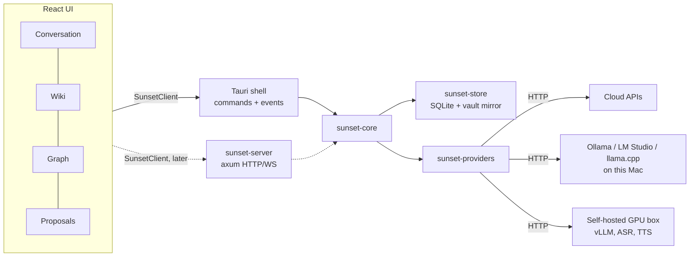

# Architecture Direction (Proposed)

**Status:** Proposed, 2026-11-08. Not yet confirmed. Change it freely; record the decision here when you do.

**Relationship to `docs/initial/initial.md`:** The initial spec describes the product and evaluates
technologies. It assumes a web app with a Python/FastAPI backend and PostgreSQL. This document
adapts that spec to the direction chosen on 2026-11-08: **a local-first macOS desktop app built with
Tauri, with an optional server later.** Where the two documents disagree on *technology*, this one
wins. Where they disagree on *product behavior*, the initial spec wins.

---

## 1. Guiding decisions

| # | Decision | Why |
|---|---|---|
| D1 | **Local-first desktop app first** (macOS, Tauri v2). No server in v1. | The core value is the app itself. A server adds auth, hosting and sync before the learning loop is proven. |
| D2 | **Two tiers inside one repo, split by Rust crates, not by processes.** All business logic lives in a transport-agnostic `core` crate. The Tauri shell is a thin adapter. A future `server` crate wraps the same core over HTTP/WebSocket. | Gives the web-app path later without paying the client/server cost now. |
| D3 | **Bring your own model. Bundle no models.** Every AI capability (chat LLM, embeddings, speech-to-text, text-to-speech, realtime voice, document parsing) is reached over the network through a provider adapter. A local Ollama or a self-hosted GPU box is the same kind of thing as a cloud API. | The model landscape is the biggest uncertainty. Keeping models out of the binary keeps the app small and lets us swap models without rebuilding. |
| D4 | **SQLite is the source of truth on device.** Plain Markdown is a mirror for user ownership. | Single file, zero setup, fast, easy to back up. Personal-scale data does not need PostgreSQL. |
| D5 | **The AI never writes the database directly.** It produces typed *proposals*; the core validates, applies policy (auto-save vs approval), and commits revisions. | Product requirement: reviewable, reversible capture (initial spec Part II §4.2, §7.4). |
| D6 | **Text first, voice second.** Build the full learning loop with typed input before touching audio. | Voice is the riskiest and most provider-dependent part. The knowledge loop must not depend on it. |

---

## 2. Layout

`[P0]`, `[P1]`, ... mark the build phase (§8) that creates an item. `[Later]` means after the
phases in §8.

### 2.1 Repository

```text
project-sunset/
├── .github/workflows/ci.yml   # [P0] manual only; checks run locally with `pnpm check`
├── .editorconfig              # [P0]
├── rust-toolchain.toml        # [P0] pinned Rust version
├── Cargo.toml                 # [P0] Rust workspace
├── package.json               # [P0] pnpm workspace root and scripts
├── pnpm-workspace.yaml        # [P0]
├── app-identity.json          # [P0] product name + bundle id, the only place they are written (§2.7)
├── crates/                    # all Rust logic
├── apps/                      # runnable apps (desktop now, web later)
├── packages/                  # shared TypeScript code
├── docs/
├── eval/                      # [P3] Cantonese / English test sets and benchmarks
└── scripts/                   # [P0] small dev scripts (identity sync, binding generation)
```

### 2.2 Rust crates

Dependencies point one way. `sunset-domain` holds plain data types so that `sunset-store` and
`sunset-core` can share them without a cycle. `sunset-providers` is a plain AI client library and
knows nothing about concepts or articles.

```text
sunset-domain  ←  sunset-store  ←┐
                                 ├─  sunset-core  ←  apps/desktop/src-tauri
sunset-providers  ←──────────────┘                ←  sunset-server [Later]
```

**`sunset-domain`**: data types only, no I/O. TypeScript bindings are generated from these types.

```text
crates/sunset-domain/src/
├── identity.rs      # AppIdentity (product name, bundle id), injected at startup (§2.7)
├── ids.rs           # typed UUIDv7 ids (SessionId, ConceptId, ...)
├── session.rs       # Session, Turn
├── concept.rs       # Concept, Alias
├── article.rs       # ArticleRevision, section structure
├── relation.rs      # Relation + closed set of relation types (IS_A, PART_OF, USES, ...)
├── observation.rs   # LearningObservation (private overlay): questions, confusions, familiarity
├── visual.rs        # VisualArtifact + typed VisualPayload (§3.1); never model-written HTML/JS
├── source.rs        # Source, SourceSpan [P4]
├── proposal.rs      # Proposal, Patch, Evidence, lifecycle state
├── commit.rs        # Commit (append-only, undo_of)
├── settings.rs      # user settings, save mode (auto / approval)
└── events.rs        # app event enum (turn.finalized, proposal.created, ...)
```

**`sunset-providers`**: AI model access.

```text
crates/sunset-providers/src/
├── traits.rs        # ChatModel, Embedder; later SpeechToText, TextToSpeech, RealtimeVoice
├── types.rs         # ChatRequest, ChatDelta, ChatCapabilities
├── probe.rs         # [P1] Test connection: basic request, streaming, JSON schema, tool calls
├── structured.rs    # [P1] find the JSON in a reply (reasoning blocks, code fences)
├── secrets.rs       # [P1] SecretStore; macOS Keychain (keyring-core + apple-native store)
├── local.rs         # [P1] is a base URL local (this Mac, LAN, tailnet)?
├── sse.rs           # [P1] streaming SSE parser
└── adapters/
    ├── mock.rs           # [P0] deterministic answers for tests and Phase 0
    ├── openai_compat.rs  # [P1] Ollama, LM Studio, llama.cpp, vLLM, OpenRouter, OpenAI, ...
    ├── anthropic.rs      # [P1/P2]
    └── gemini.rs         # [Later] when a feature needs it
```

**`sunset-store`**: SQLite and the Markdown vault.

```text
crates/sunset-store/
├── migrations/0001_init.sql   # [P0] canonical tables (initial spec Part II §7.2)
└── src/
    ├── db.rs                  # open, migrate, pool
    ├── repo/                  # one file per table: sessions.rs, concepts.rs, proposals.rs, ...
    ├── search/fts.rs          # [P2] FTS5 trigram (works for Cantonese)
    ├── search/vector.rs       # [P2] embeddings + brute-force cosine
    ├── vault/mirror.rs        # [P2] write vault/<slug>.md after each commit
    └── vault/export.rs        # [P2] export without the private overlay
```

**`sunset-core`**: all business logic.

```text
crates/sunset-core/
├── src/
│   ├── app.rs             # `Sunset`: entry point; owns store, providers, event bus, job runner
│   ├── error.rs
│   ├── bus.rs             # tokio broadcast event bus
│   ├── conversation/
│   │   ├── session.rs     # open/close sessions, record turns
│   │   ├── tutor.rs       # fast path: stream the tutor answer
│   │   └── context.rs     # [P2] bounded context (related concepts, preferences)
│   ├── knowledge/         # slow path: background capture
│   │   ├── gate.rs        # worth capturing? (classifier role)
│   │   ├── curator.rs     # turn → proposals
│   │   ├── validate.rs    # schema, evidence and duplicate checks
│   │   ├── policy.rs      # auto-save or wait for approval
│   │   └── apply.rs       # commit; undo as a compensating commit
│   ├── jobs/
│   │   ├── runner.rs      # durable jobs in the `jobs` table, resumed on restart
│   │   └── kinds.rs       # CurateTurn, EmbedConcept, ...
│   ├── tools/             # [P2] Tool trait, built-in tools, MCP client (rmcp)
│   └── prompts/           # prompt templates as .md files, not Rust string literals
└── tests/                 # cross-crate tests: approval mode, undo, duplicate concepts
```

**`sunset-server`** `[Later]`: axum HTTP + WebSocket wrapper around `sunset-core` for a web client.

### 2.3 Apps and frontend packages

The UI lives in `packages/ui`, not inside the desktop app, so a web app can reuse it with a
different `SunsetClient` implementation.

```text
apps/
├── desktop/
│   ├── index.html, vite.config.ts, package.json
│   ├── src/
│   │   ├── main.tsx              # mounts <App client={tauriClient} />
│   │   └── tauri-client.ts       # SunsetClient over Tauri invoke + listen
│   └── src-tauri/
│       ├── tauri.conf.json       # identity fields are synced from app-identity.json (§2.7)
│       ├── capabilities/         # Tauri v2 permissions, minimum needed
│       ├── Info.plist            # [P3] microphone usage description
│       ├── icons/
│       └── src/
│           ├── main.rs, lib.rs   # start sunset-core, register commands
│           ├── commands/         # conversation.rs, knowledge.rs, settings.rs (thin)
│           └── events.rs         # core events → Tauri events
└── web/                          # [Later] SunsetClient over HTTP/WS + the same UI

packages/
├── bindings/     # generated TypeScript types; never hand-edited
├── client/       # SunsetClient interface: the contract between UI and backend
└── ui/           # shared React UI
    └── src/
        ├── App.tsx
        ├── features/
        │   ├── conversation/   # transcript, input, next-topic chips
        │   ├── proposals/      # quiet proposal drawer: approve / reject / undo
        │   ├── wiki/           # articles, backlinks, private overlay toggle, history
        │   ├── graph/          # focused Cytoscape.js graph
        │   ├── settings/       # providers, roles, Test connection
        │   └── onboarding/     # short first-run questions
        ├── components/, hooks/, styles/
        └── state/              # TanStack Query (backend data) + Zustand (UI state)
```



### 2.4 Docs

```text
docs/
├── initial/initial.md     # original idea; not edited
├── architecture.md        # this document
├── decisions/             # ADRs, one short file per significant decision
└── guides/
    ├── development.md     # setup and running
    └── providers.md       # [P1] connecting Ollama, LM Studio, self-hosted servers
```

### 2.5 Data on the user's Mac

```text
~/Library/Application Support/<bundle-id>/
├── library.sqlite     # source of truth
├── files/             # uploaded PDFs, images [P4]
└── logs/
~/Documents/<Product Name> Vault/   # [P2] Markdown mirror; user picks the location
macOS Keychain                       # API keys, service name = bundle id
```

### 2.6 Walkthrough: typing "What is a VAE?"

1. The UI calls `client.sendMessage()`, which reaches `sunset-core` through a Tauri command.
2. `conversation/tutor.rs` streams the answer back right away (fast path).
3. When the turn finishes, the bus emits `turn.finalized` and `jobs` queues a `CurateTurn` job
   (slow path; the answer never waits for it).
4. `gate.rs` decides whether the turn is worth capturing. If so, `curator.rs` drafts proposals and
   `validate.rs` checks them.
5. `policy.rs` either commits through `apply.rs` (auto mode) or emits `proposal.created` so the
   drawer count goes up (approval mode).
6. Reject or Undo makes `apply.rs` append a compensating commit. History is never deleted.

### 2.7 App identity (temporary name)

"Sunset" is a working name. The product name and bundle id will change before the first release,
so they are written in exactly one file:

```jsonc
// app-identity.json
{ "productName": "Sunset", "bundleId": "dev.sennett.sunset" }
```

How each place gets them:

| Where | Field(s) | How |
|---|---|---|
| `apps/desktop/src-tauri/tauri.conf.json` | `productName`, `identifier`, main window `title` | Copied by `pnpm identity:sync`. `pnpm check` runs `pnpm identity:check`, which fails if they drift. |
| Rust (`src-tauri`) | both | Read at runtime from the Tauri config, turned into `sunset_domain::AppIdentity`, passed to `sunset-core`. |
| `sunset-core` and below | both | Only through the injected `AppIdentity`. Never a string literal. |
| App data directory | bundle id | Derived by Tauri (`app_data_dir()`); passed into the core as a path. |
| Keychain service name | bundle id | `AppIdentity::keychain_service()`. |
| Vault folder default | product name | `AppIdentity::default_vault_folder_name()`. |
| TypeScript UI | product name | Imports `app-identity.json` at build time. |

**Renaming checklist:** edit `app-identity.json`, run `pnpm identity:sync`, commit both. Changing
the bundle id moves the app data directory and Keychain entries, so it is a breaking change once
real users exist. Do it before the first public build, or ship a migration with it.

**Code name vs product name:** `sunset-*` crate and package names, the repo name and the `Sunset*`
type names are internal code names. They do not have to change with the product name.

---

## 3. Data storage

**On device:** one SQLite file per knowledge library in the app data directory
(`~/Library/Application Support/<bundle-id>/`), plus a `files/` folder for uploads and artifacts.

- **Access:** `sqlx` with SQLite and versioned migrations. `sqlx` also supports PostgreSQL, which
  keeps the door open for `sunset-server`.
- **Schema:** use the canonical tables from the initial spec Part II §7.2: `sessions`, `turns`,
  `concepts`, `article_revisions`, `relations`, `learning_observations`, `sources`, `source_spans`,
  `claims`, `visual_artifacts`, `proposals`, `commits`, `jobs`. Desktop v1 has one local user, but
  keep a `user_id`/`library_id` column so the server can reuse the schema.
- **IDs:** UUIDv7 everywhere (sortable, generated offline, safe to merge later).
- **History:** `commits` is append-only. Undo is a compensating commit. This log is also the future
  sync unit.
- **Lexical search:** SQLite FTS5. Use the `trigram` tokenizer (or a second index) so Cantonese and
  other CJK text, which has no spaces, is searchable.
- **Semantic search:** store embeddings with their model name and dimension. Start with brute-force
  cosine in Rust (a personal library is thousands of chunks, not millions). Move to `sqlite-vec` only
  when measurement says so.
- **Markdown vault mirror** `[P2]`: after each commit, write one file per concept,
  `vault/<slug>.md`. YAML frontmatter holds aliases and typed relations in both directions
  (outgoing and incoming); the body links every related concept with `[[WikiLinks]]`, so links
  work both ways in Obsidian. Private learning observations go to
  `vault/.private_overlay/<slug>.md` and are excluded from any export. The mirror is one-way
  (DB → files) in v1.
- **Personal learning overlay** (decided 2026-11-08): per concept, the learner's own questions and
  confusions, each linked to the `TurnId` (later also `SourceSpan`) it came from, plus
  self-reported familiarity. Generated self-check questions, quizzes and spaced revisits are
  **not** in v1 (initial spec Part I §13: out of scope for the initial product commitment).

### 3.1 Visual artifacts (decided 2026-11-08)

Teaching visuals are typed data, never model-written HTML or JavaScript (initial spec Part II §9.2
and the "uncontrolled generated visuals" risk). The model emits a `VisualPayload`; the core
validates it with `serde` plus per-kind checks; the UI renders it with trusted components.

| `kind` | Payload | Rendered by |
|---|---|---|
| `concept_flow` | nodes + edges (the VAE example in §9.2) | built-in SVG component `[P0]` |
| `mermaid` | diagram source | Mermaid with `securityLevel: "strict"` `[P1–2]` |
| `plot` | plot type, axis labels, data series | chart component `[P1–2]` |
| `parameter_explorer` | slider params + a preset naming a trusted component (e.g. 1-D Gaussian) | trusted React component, sliders only `[P1–2]` |
| `equation_steps` | ordered LaTeX steps with explanations | KaTeX `[P1–2]` |

Adding a renderer must not change the schema: payloads are stored as JSON with a
`renderer_version`. Visuals attach to an article revision so they stay tied to the content and
sources used to make them.
- **Secrets:** provider API keys live in the macOS Keychain (`keyring` crate). Never in SQLite,
  config files or the webview.

**Cloud later, in this order:** (1) manual export/backup of the vault + DB snapshot; (2) folder
sync (iCloud Drive / any synced folder) of exports; (3) `sunset-server` with commit-log replication
for multi-device and web access. Do not design (3) now beyond UUIDv7 IDs and the append-only log.

---

## 4. Connecting to AI models

### 4.1 Separate interfaces per capability

Do not model everything as one `generate()` call (initial spec Part II §8.1). In `sunset-providers`:

```rust
// Illustrative. Real signatures will settle during Phase 0.
#[async_trait]
pub trait ChatModel: Send + Sync {
    async fn complete(&self, req: ChatRequest) -> Result<ChatResponse>;
    async fn stream(&self, req: ChatRequest) -> Result<BoxStream<'static, Result<ChatDelta>>>;
    fn capabilities(&self) -> &ChatCapabilities; // tools, json_schema, vision, context_window
}

#[async_trait]
pub trait Embedder: Send + Sync {
    async fn embed(&self, texts: &[String]) -> Result<Vec<Vec<f32>>>;
    fn model_id(&self) -> &str;
    fn dimension(&self) -> usize;
}

// Later: SpeechToText, TextToSpeech, RealtimeVoiceSession, DocumentParser.
```

### 4.2 Adapters, in build order

1. **OpenAI-compatible** (`/v1/chat/completions`, `/v1/embeddings`, `/v1/models`). One adapter
   covers Ollama, LM Studio, llama.cpp server, vLLM, MLX-LM, OpenRouter, OpenAI, and most
   self-hosted servers. Build this first; it alone satisfies "connect to my self-hosted model".
2. **Anthropic** native API (different request shape, best-in-class tool use).
3. **Gemini** native API, when a feature needs it (e.g. audio input for Cantonese STT).

Write a thin client on `reqwest` + `serde` with our own SSE parsing. Local servers deviate from
the OpenAI spec in small ways, and a thin client makes those quirks easy to handle.

### 4.3 Provider profiles and roles

A **provider** is an endpoint (`kind`, `base_url`, keychain key reference, discovered models).
A **role** maps a job to a provider + model. Users configure roles, not one global model:

| Role | Job | Typical choice |
|---|---|---|
| `tutor` | Answer and teach, streamed to the user | Strongest model the user can afford |
| `curator` | Turn stable turns into structured proposals | Mid/strong model with reliable structured output |
| `classifier` | Cheap yes/no gates ("worth capturing?", "is this a rejection?") | Small local model |
| `embedder` | Embeddings for retrieval | Local or cloud embedding model |
| `stt` / `tts` / `voice` | Later | See initial spec Part II §3.5–3.6 |

### 4.4 Capability probing, not assumptions

An "OpenAI-compatible" URL says nothing about tool calling, JSON schema support or context length.
On "Test connection" the app runs small probes and stores the result with a timestamp. Unknown
stays `needs_test`; features that need a missing capability are disabled with a clear message.

Structured output strategy, in order: native JSON schema → tool call → plain JSON in the prompt.
Always validate with `serde` and retry with the validation error once. Never trust unvalidated
model output.

### 4.5 Privacy rules

- Requests go from Rust, never from the webview. Keys never reach JavaScript; no CORS problems.
- Never fall back silently from a local provider to a cloud one. Any fallback that sends data to a
  new provider needs explicit opt-in.
- Label a profile "local" only when every role in it is local.

---

## 5. Integrating external APIs and tools

- **Internal tool trait** in `sunset-core` (`name`, JSON input schema, `run`). The tutor/curator
  see tools; the core executes them and checks permissions.
- **MCP client** (the official Rust SDK, `rmcp`) as one tool source, so users can plug in web search,
  browsers, file systems and repos without us writing each integration.
- **Built-in tools** only where the product needs tight control: knowledge-base search, source
  lookup, proposal creation.
- **Python-only tools** (Docling, Qwen3-ASR, LiveKit/Pipecat pipelines) are reached the same way
  as models: as HTTP services the user runs (e.g. `docling-serve`). A Tauri sidecar is a later
  option if bundling becomes necessary.

---

## 6. Runtime inside the app

- `sunset-core` runs on `tokio`. Long jobs (curation, embeddings, document parsing) are rows in the
  `jobs` table, executed by an in-process worker pool, idempotent, and resumed on restart.
- An internal event bus (`tokio::sync::broadcast`) carries typed events
  (`turn.finalized`, `proposal.created`, `revision.committed`, `job.progress`, ...). The Tauri
  shell forwards them to the UI as Tauri events; `sunset-server` will forward them over WebSocket.
- The fast path (tutor reply) never waits on the slow path (curation). Initial spec Part II §5.

### 6.1 Delivering background results (decided 2026-11-08)

Background results reach the user on two channels with different timing:

- **Quiet channel, immediate:** state changes the user can glance at, such as the proposal
  drawer badge, a source link or a "needs correction" marker. Emitted as events as soon as the
  commit or proposal exists.
- **Active channel, deferred:** anything that would speak or take focus ("I found a source for
  that", a correction offer). Held in a delivery queue in `sunset-core` and released only in a
  safe turn window: the user is not speaking or typing and the tutor is not mid-answer. Entries
  carry `{session_id, topic_version, turn_id, job_id}` and are re-checked on release; stale ones
  go to activity history instead (initial spec Part II §5.4).

Phases 0–1 have only the quiet channel. The queue arrives with the first active notice (likely a
source found or a correction offer, `[P2]` text, `[P3]` voice).

---

## 7. Voice (deferred, notes only)

- Audio capture in Rust with `cpal` keeps one code path for local STT and avoids webview
  microphone-permission quirks. Hosted WebRTC sessions (OpenAI Realtime, Gemini Live) may be easier
  from the webview. Decide in a spike.
- The macOS app needs `NSMicrophoneUsageDescription` in `Info.plist`.
- Every voice path must produce the same finalized `turn` events, so the knowledge pipeline does not
  care which voice provider produced them.

---

## 8. Build phases (adapted from initial spec Part II §12)

| Phase | Goal | Exit |
|---|---|---|
| **0. Skeleton** | Workspace, Tauri shell, `SunsetClient`, SQLite schema + migrations (all canonical tables, including `visual_artifacts` and `learning_observations`), generated bindings, mock provider. | App opens; typing "What is a VAE?" streams a mock answer and creates one deterministic proposal (concept + article, relation, personal observation, `concept_flow` visual); approve/reject/undo changes the wiki. Covered by a Rust end-to-end test. |
| **1. Real text loop** (implemented; real-model check pending) | OpenAI-compatible adapter, provider settings + Keychain, capability probe, streamed tutor answers, real curator proposals, wiki + focused graph. | Same loop with a real model (cloud *or* local Ollama), unchanged pipeline. |
| **2. Retrieval + personal overlay** | FTS + embeddings, bounded context assembly, learning observations, Markdown vault mirror, export without private overlay. | Return days later; the tutor uses earlier concepts; export excludes private notes. |
| **3. Voice spike** | One hosted voice path and one chained STT→LLM→TTS path behind the same turn contract. Cantonese benchmark set. | Spoken VAE conversation; reject a proposal by voice while talking. |
| **4. Sources + visuals** | PDF ingestion via an external parser, citation anchors, typed diagram artifacts. | Paper-backed proposal with correct page reference. |
| **Later** | `sunset-server`, sync, web client, sharing. | — |

### 8.1 Phase 0 notes (done 2026-11-08)

- **Undo:** knowledge rows carry `created_by_commit_id`; an undo commit sets
  `retracted_by_commit_id` on every row the original commit made. Reads return live rows only.
  Proposal status changes are guarded (`awaiting_approval → committed` succeeds once).
- **Jobs:** curation is a durable `curate_turn` job. Its proposals and its completion are written
  in one transaction, so a crash re-runs the job without duplicates.
- **Mock models:** `sunset_core::mock` scripts the tutor and curator for one topic. The providers
  crate's `MockChatModel` takes its answers from the caller and knows nothing about the product.
- **Bindings:** tauri-specta (pinned pre-release) generates commands, the `coreEvent` event and
  all types. Commands throw on error. `disable_serde_phases` keeps one TS type per Rust type.
  Specta exports `f64` as `number | null` (JSON has no NaN); validation rejects non-finite values.
- **UI:** the event handler cancels in-flight queries before invalidating, so an event that lands
  during a fetch is never lost. Zustand is not used yet; local React state is enough so far.
- **Phase 0 shortcuts to revisit:** the graph is a plain SVG circle (Cytoscape.js in Phase 1);
  Markdown is a tiny safe subset; an existing concept's aliases are not merged on upsert; the
  curator JSON schema is a placeholder until it is derived from the Rust types.
- Rust minimum is 1.94 (required by sqlx 0.9); the pinned toolchain is 1.98.1.

### 8.2 Phase 1 notes (implemented 2026-11-08; real-model run pending)

- **Providers and roles** live in SQLite (`providers`, `role_assignments`, `model_capabilities`,
  migration 0002). A built-in `demo` provider is created on first run and every unassigned role
  points at it, so the app works before any model is set up. Roles in v1: `tutor`, `curator`
  (`classifier` and `embedder` arrive with Phase 2).
- **Adapter:** one OpenAI-compatible adapter on `reqwest` (native TLS) with our own SSE parser.
  Structured output follows the probe: JSON schema → forced tool call → schema in the prompt.
  Untested models get the prompt path. A model whose streaming is `unsupported` gets one chunk.
- **Secrets:** `keyring-core` + `apple-native-keyring-store` (the `keyring` crate's v4 split),
  behind a `SecretStore` trait so tests use memory. `has_api_key` is the only trace in SQLite.
- **Curator:** the JSON schema is generated from `CuratorOutput` with `schemars`; the request
  lists existing concepts with aliases. Replies may contain `<think>` blocks or fences. Names are
  normalized before validation (`NameIndex`): a synonym of an existing concept reuses it, and
  new names become rows in `concept_aliases`, undone with their commit.
- **No fallback:** a failing role surfaces `tutor_failed` / `job_failed`; nothing is re-sent
  elsewhere.
- **UI:** Models panel (providers, keys write-only, roles, Test connection, local/cloud labels),
  react-markdown with `[[wikilinks]]` (no raw HTML, external links do not navigate), focused
  Cytoscape.js graph loaded lazily.
- **Tests:** `crates/sunset-core/tests/phase1_real_provider.rs` drives the loop through the real
  adapter against a local fake OpenAI server. The exit criterion with a real model (Ollama or a
  cloud API) is still to be run by hand: see `docs/guides/providers.md`.
- **Known gaps:** no context-window probe; `<think>` text from reasoning models that put it in
  `content` is shown in tutor answers; curator prompt sees at most 300 existing concepts.

---

## 9. Defaults and open decisions

**Defaults (chosen 2026-11-08, easy to change before much UI exists):**

| Area | Default |
|---|---|
| UI | React + Vite + TypeScript (strict) |
| State | TanStack Query (backend data) + Zustand (UI state) |
| Styling | Tailwind CSS |
| Graph | Cytoscape.js |
| TypeScript bindings | `specta` / `tauri-specta` |
| Product name / bundle id | `Sunset` / `dev.sennett.sunset`, **temporary** (§2.7) |

**Open:**

1. Final product name and bundle id (before the first release; §2.7).
2. Voice capture location: Rust (`cpal`) vs webview.
3. Minimum macOS version and Apple Silicon only vs universal binary.
4. Open-source license.
5. Product decisions still open in initial spec Part I §22.
