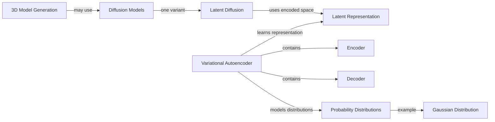
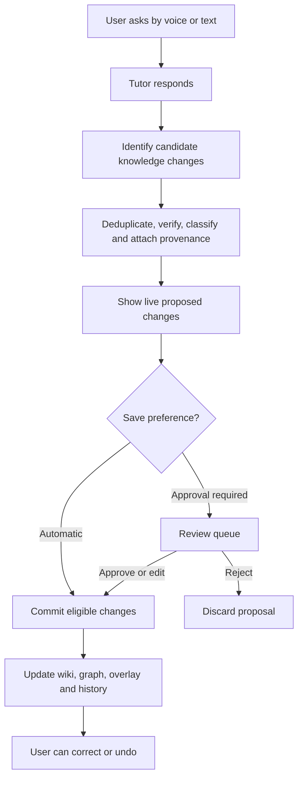
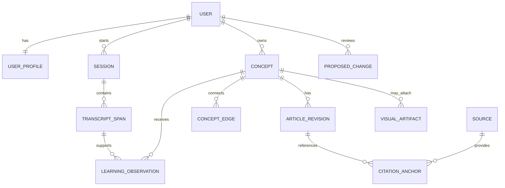
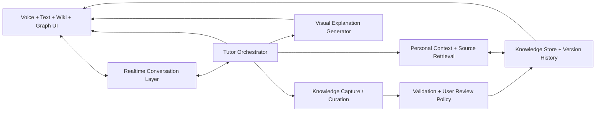
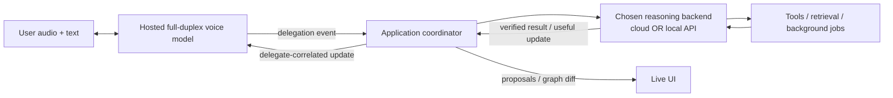
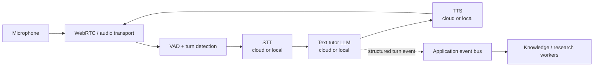
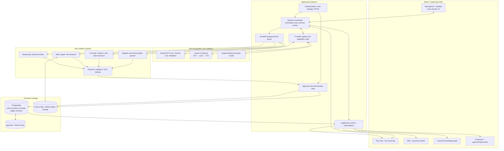
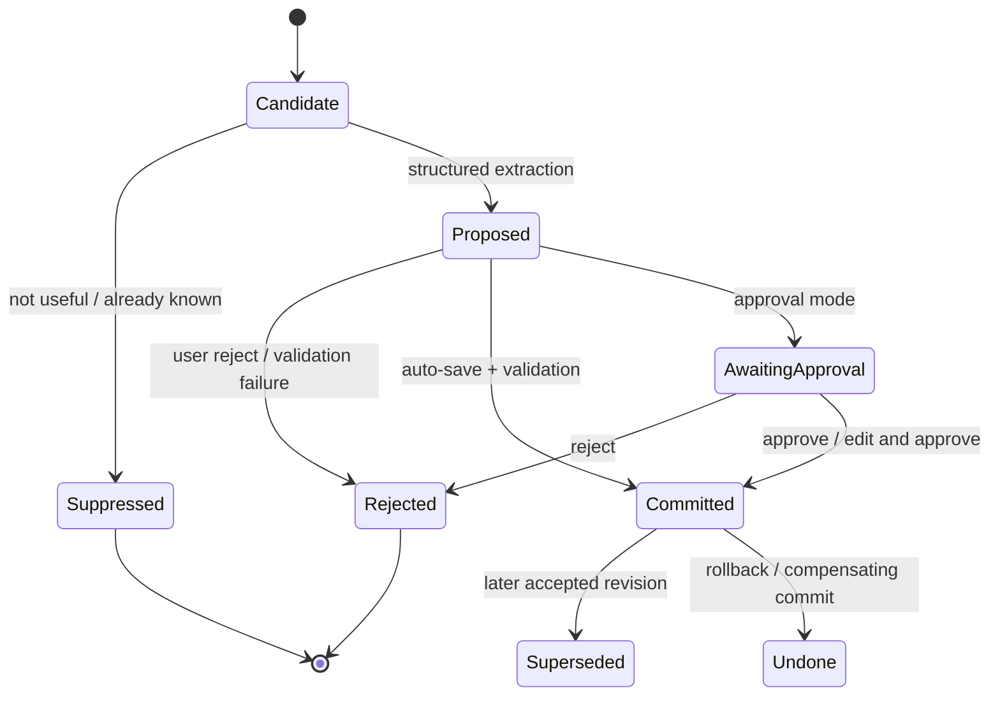

# Voice-First Personal Knowledge Tutor
## Unified Product Blueprint & Technical Architecture Specification (v0.2)

**Document Status:** Unified Product PRD + Technical Architecture RFC (with v0.2 Architecture Review Upgrades)  
**Date:** 2026-11-03  
**Version:** 0.2 (Combined & Revised from `voice_first_personal_knowledge_tutor_blueprint.md` v0.1 and `voice_first_knowledge_tutor_technical_research_architecture.md` v0.1)  
**Primary Constraint:** An open-source application supporting hosted AI APIs, self-hosted local model APIs, or hybrid profiles, with first-class **Hong Kong Cantonese + English technical code-switching**.

---

## 📌 Summary of v0.2 Review Upgrades & Revisions

1. **Combined Single-Source Specification:** Merged the *Product Blueprint (Concept PRD)* and *Technical Architecture RFC* into one cohesive two-part specification (**Part I: Product Blueprint & UX**, **Part II: Technical Architecture, Stack Evaluation & POC Plan**), reconciling entity naming across both documents.
2. **Upgraded Intent & Capture Gate (`LiquidAI/d1-2B`):** Replaced generative small-model JSON prompting (`LFM3-1.7B`) on the hot capture path with **`LiquidAI/d1-2B`** (`system_one` decision model, ~5–15 ms single forward pass, calibrated `noul`/`choice` probabilities) to decide whether a turn warrants a note proposal, diagram, source lookup, or proposal rejection without JSON syntax failures.
3. **Strengthened Hong Kong Cantonese Speech Stack:** Added **MiniMax (`speech-02-hd` / `t2a_v2`)** and **Fish Speech / GPT-SoVITS** to the Cantonese TTS evaluation matrix (addressing the robotic prosody of standard cloud `zh-HK` voices on English code-switched terms), and added **SenseVoice-Small (`yue`)** + **Gemini 2.5 Flash Audio** to the Cantonese STT matrix.
4. **Anti-Distraction UX Gate (Quiet Proposal Drawer + Sub-Topic Settled Trigger):** Refined live capture UX so background proposals accumulate quietly in a compact badge drawer while the tutor is speaking, expanding into graph/wiki diffs only at natural topic pauses, on user click, or upon voice commands (*"Don't save that"*).
5. **Deterministic Markdown / Obsidian Vault Mirror:** Added an automatic local `.md` mirror (`vault/<slug>.md` with YAML frontmatter and `[[WikiLinks]]`, strictly separated from `.private_overlay/`) synced from PostgreSQL commits so users retain plain-text ownership of their knowledge base.

---

# PART I — Product Blueprint & Concept PRD

## 1. Executive Summary

Most AI chat experiences are good at answering a question in the moment but poor at preserving a learner's growing conceptual understanding. A user can spend hours discussing diffusion models, encoders, latent spaces, probability distributions, and 3D generation, yet later struggle to remember how these ideas connect or which explanation finally made a difficult concept click.

This project aims to turn those otherwise ephemeral conversations into a **living personal learning environment**. The user initiates a topic by speaking or typing. An AI agent primarily acts as a **teacher**: it explains, adapts its depth to the learner, responds to follow-up questions, and optionally offers related topics when the conversation naturally reaches a stopping point. In parallel, the application proposes and updates a structured knowledge base consisting of interlinked wiki articles, a navigable concept graph, source references, and a separate personal learning overlay.

The learner should be able to watch the knowledge base evolve while continuing the conversation, correct its contents immediately, and choose between **automatic saving** and **approval-before-saving**. Some explanations may be more effective as diagrams, interactive charts, animations, or sourced images rather than as text alone; these are supported as distinct learning artifacts.

Each user starts with an **empty personal knowledge base**, not a shared global encyclopedia. Onboarding collects a minimal self-described background and learning preferences. The system learns additional preferences and possible knowledge gaps from actual interactions, with explicit uncertainty and user control. General-purpose knowledge remains separable from private annotations so that articles can eventually be shared or imported without leaking personal learning history.

The intended outcome is **a personal Wikipedia that grows through conversation, with an AI tutor and an evidence-backed learning history attached**—not merely a chatbot with memory, a note-taking tool, or a generic graph editor.

## 2. Problem Statement and Opportunity

### 2.1 Problems to solve

1. **Fragmented learning:** Explanations are scattered across chats, code repositories, papers, and websites.
2. **Forgetting context:** Users forget definitions, relationships, important caveats, and the reason they asked a question.
3. **Unstructured transcripts:** A chat log records the sequence of messages but does not automatically organize the underlying concepts.
4. **Missing personal context:** A conventional article does not know whether a specific learner prefers implementation details, intuitive analogies, visual demonstrations, or product-level explanations.
5. **Poor traceability:** Summaries may omit the specific exchange, source page, or example that established a point.
6. **High note-taking friction:** Manually switching between learning, note-taking, tagging, linking, and drawing disrupts the conversation.
7. **Knowledge overload:** Recording every mention of every term creates a large but low-value graph.

### 2.2 Product opportunity

Combine the strengths of a conversational AI tutor, wiki-style hyperlinked articles, a personal knowledge graph, evidence-linked learning memory, and dynamic teaching visuals in one experience. The product's differentiator is not graph rendering by itself: it is the **continuous, user-controllable conversion of a learning conversation into useful, revisitable knowledge**.

## 3. Agreed Product Direction vs. Proposals

The following distinction is important: this document records ideas discussed so far, but does not silently treat every recommendation as a finalized decision.

### 3.1 Confirmed direction from the discussion

| Area | Current decision |
| --- | --- |
| Primary experience | Voice-first conversational learning; also allow text input. |
| Agent role | Primarily an AI **teacher**, not a fully autonomous research partner. |
| Conversation initiation | User starts with a question or topic; no mandatory project selection. |
| Topic continuation | When a topic seems complete, the agent may suggest related topics via optional selectable UI elements. |
| Knowledge ownership | Each user begins with an empty, independent personal knowledge base. |
| Onboarding | Ask briefly about background, interests, goals, and preferred explanatory depth. |
| Knowledge presentation | Wikipedia-like linked topic pages, complemented by a growing graph view. |
| Personalization | Keep broadly useful knowledge distinct from user-specific observations and learning notes. |
| Capture timing | Allow the user to see incremental knowledge updates during a conversation; avoid requiring end-of-session processing only. |
| Save controls | Support both automatic saving and approval-before-saving, selectable by the user. |
| Corrections | Users should be able to remove or correct unnecessary and incorrect notes during the conversation. |
| Learning materials | Beyond prose, support diagrams, graphs, animations, images, and external material where appropriate. |
| Inputs | Allow documents such as research papers and links to websites as conversation context. |
| Provenance | Preserve links to earlier relevant questions/answers and external sources. |
| Initial languages | Cantonese and English, with a design extensible to more languages. |
| Development intent | Open-source project, starting from a practical prototype and iterating based on UX feedback. |

### 3.2 Recommended, but not yet finalized

- Prefer a **wiki article as the durable reading unit**, with the graph as a contextual exploration tool rather than the only interface.
- Use an **ephemeral/proposed → draft/review → saved** content lifecycle.
- Distinguish **general article content, personal overlay, source evidence, and temporary teaching visuals** as separate entities.
- Start with a lightweight **version history, diff, and undo** instead of a full Git-like branching system.
- Let a single orchestrated AI workflow implement several responsibilities; a complex multi-agent architecture is not inherently required.
- Generate concise article stubs for newly encountered terms; expand only when the user meaningfully explores them.
- Keep every fact and learning inference **traceable and correctable** rather than treating model guesses as established knowledge.

## 4. Product Principles

1. **Learning comes first.** The application should never make the learner wait for note generation before hearing a useful answer.
2. **Conversation is natural.** Starting a question should feel like opening a chat, not configuring a project or folder.
3. **Structure emerges progressively.** The AI can suggest new concepts and links, but should not create an encyclopedia-sized graph from one question.
4. **The learner retains control.** Suggestions, captured notes, and inferred personal preferences must be reviewable and reversible.
5. **General knowledge and personal observations are separate.** This separation enables privacy-conscious sharing and reuse.
6. **A claim is not the same thing as its evidence.** Generated explanations, user statements, papers, and web results have distinct provenance.
7. **A graph is a navigation aid, not a dumping ground.** Only useful relationships should become visible nodes and edges.
8. **Visuals should teach.** A diagram or animation exists to improve understanding, not merely decorate a response.
9. **Personalization must be revisable.** A learner's background is not a permanent limit on what they can understand.
10. **Open-source architecture should avoid unnecessary lock-in.** Model and speech providers should be replaceable where practical.

## 5. Target Audience and Representative Use Cases

The initial target user is a curious technical learner who often encounters unfamiliar concepts through engineering projects, research papers, or codebases. The system should not assume users have technical backgrounds: the same mechanisms should support general learners with different goals and preferences.

Representative scenarios:

- **Learning while building:** A developer working on image-to-3D generation asks about VAEs, diffusion models, and Gaussian distributions. The system connects the concepts without confusing project-specific notes with general explanations.
- **Understanding a paper:** A learner uploads a research paper, asks about a section, and receives an explanation with page/section references and links to concepts in their wiki.
- **Correcting live capture:** The agent proposes a definition for an already-familiar term. The learner says, “I know this; don't add it,” and the proposal disappears without disrupting the voice conversation.
- **Revisiting a previous difficulty:** Weeks later, the learner opens a page about latent spaces and sees an optional personal annotation linked to the earlier conversation in which they struggled with the abstraction.
- **Exploring related ideas:** After finishing a topic, the application shows a small set of relevant next-topic choices. The learner may select one, type a new question, or end the session.
- **Sharing knowledge:** The learner eventually exports or shares a useful general wiki article without exposing personal misconceptions, profile information, or conversation history.

## 6. High-Level User Experience

### 6.1 First-run onboarding

A new account starts with **no concept articles or graph nodes**. Onboarding should be brief, optional where possible, and editable later. Suggested prompts include:

- “What topics are you interested in learning?”
- “What is your background or experience level?”
- “Do you prefer practical examples, detailed technical explanations, or a mix?”
- “Would you prefer that notes save automatically, or that you review them first?”
- “Which language would you like to speak and read in?”

The system must not mistake self-reported background for evidence of mastery. The learner can skip questions and adjust preferences as experience develops.

### 6.2 Starting a conversation

The user begins with a spoken or typed question, such as:

> “I'm looking at a 3D generation repository. What exactly does a VAE do, and why would a diffusion model use one?”

The agent begins teaching immediately. It may ask clarifying questions when essential, but does not require the user to choose a project first. If the conversation touches an existing concept, the system can surface a related wiki page or prior explanation without interrupting the answer.

### 6.3 Learning and live capture

As the conversation develops, the system may:

1. Create a compact **proposed article stub** for “Variational Autoencoder.”
2. Connect it to “Encoder,” “Decoder,” “Latent Representation,” and a relevant diffusion-model concept where the relationship is justified.
3. Display a small, non-intrusive notification or visual change showing what was proposed.
4. Attach the relevant transcript span and any external source used.
5. Suggest a personal note if the user explicitly indicates a confusion or preference.
6. Save automatically or await approval, according to the user's chosen mode.

Live capture should be **near real time**, not necessarily a database write for every spoken token. Voice transcription may be partial, revised, or erroneous. Durable knowledge should follow a stable turn or a suitable validation checkpoint.

> 💡 **[Architecture Review Note — v0.2 UX Upgrade (Anti-Distraction Proposal Drawer)]:**  
> Popping up graph node animations or modal diff cards on *every* spoken turn creates severe cognitive load while a learner is listening to a complex explanation.  
> **v0.2 Change:** Introduce a **Sub-Topic Settled Gate + Quiet Proposal Drawer**:
> - While speech is active, new proposals silently increment a compact drawer badge (e.g. `📝 2 proposed updates · latest: Variational Autoencoder`) without rearranging the graph viewport.
> - Proposals expand into the review/graph surface only when (a) a sub-topic reaches a natural pause, (b) the user clicks the drawer, or (c) the user issues a voice command such as *"Don't save that"* / *"Show me what you changed"* (which immediately resolves against the top item in the proposal drawer).

### 6.4 Real-time correction

Supported natural-language actions could include:

- “Don't save that part.”
- “I already understand encoders; focus on latent spaces.”
- “That relationship is misleading.”
- “Keep the diagram, but remove the example from the article.”
- “Show me what you changed.”
- “Undo the last update.”

Equivalent UI actions should be available for users who prefer clicking or typing. Corrections affect the relevant proposed or saved artifact and should be reflected in later AI context.

### 6.5 Completing a topic

When the agent detects a natural stopping point, it may display **one or a few optional next-topic suggestions** (for example, “Latent diffusion,” “Gaussian distributions,” or “How VAEs are trained”). This is not permission for the agent to launch an unrelated conversation, and it must remain easy to end or start a different question.

## 7. Proposed Interface Model

The application has three complementary surfaces rather than three competing primary apps.

### 7.1 Conversation workspace — the primary interaction

- Voice interaction with interruption/barge-in support if the selected speech stack permits it.
- Text input and accessible transcripts.
- Inline answers, images, diagrams, interactive visual explanations, and external-source references.
- Subtle indicators when an article, relationship, or personal note is being proposed or saved.
- Contextual shortcuts such as **Explain further**, **Open article**, **Don't save**, **Undo**, and **Explore next**.

### 7.2 Wiki workspace — durable knowledge

- Searchable, linked article pages with concise definitions and expandable detail.
- Backlinks, related concepts, and cited sources.
- A personal learning overlay shown as distinct annotations, not inserted into the shareable article by default.
- Article state, last revision, and a history/diff view.

### 7.3 Graph workspace — conceptual exploration

- Nodes for concepts or articles; edges for meaningful relationships.
- A local or focused graph around the active concept, with optional expansion to the wider graph.
- Clear distinction between proposed and saved changes.
- Filters for relationship type, source, subject, or learning state.
- Interactions that open the corresponding wiki article, source, or personal annotation.

**UX recommendation:** On desktop, a conversation area can coexist with a contextual graph/wiki pane. On mobile, the surfaces should become tabs or swappable panels; the graph should not be forced into a tiny side panel.

### 7.4 Example conceptual screen

```text
+-----------------------------------------------------------------------+
|  Voice / Text Conversation              |  Knowledge Workspace        |
|-----------------------------------------+-----------------------------|
|  User: Why use a VAE with diffusion?    |  Focus: Latent Diffusion     |
|                                         |                             |
|  Tutor: Some diffusion models operate   |    [VAE] ---- [Latent Space] |
|  in pixel space. Latent diffusion uses  |      \          /           |
|  an encoded representation instead...  |       [Latent Diffusion]     |
|                                         |                             |
|  [Interactive latent-space diagram]     |  + Proposed changes (2)     |
|                                         |  + Review / Discard          |
|  [Speak] [Type] [Open source]           |  [Wiki] [Graph] [History]   |
+-----------------------------------------------------------------------+
```

This is a **conceptual wireframe**, not a locked layout. One of the earliest prototype goals is to discover whether live graph updates aid learning or create distraction.

## 8. Conceptual Knowledge Architecture

The application should distinguish several categories of information rather than placing everything into one graph or one long note.

| Layer | Role | Example | Sharing default |
| --- | --- | --- | --- |
| **User context/profile** | Self-described background and evolving teaching preferences | “Prefers intuitive illustrations before equations” | Private |
| **General knowledge wiki** | Reusable explanations independent of this learner | “What is a variational autoencoder?” | Private initially; potentially shareable |
| **Concept relationships** | Links between topics with meaningful semantics | “Latent diffusion operates on encoded representations” | Potentially shareable with general content |
| **Personal learning overlay** | User-specific questions, understanding signals, corrections, and reminders | “Previously asked why latent representations are useful” | Private |
| **Conversation history** | Original user/agent exchanges and timestamps | A specific question and explanation | Private |
| **Source library** | Research papers, websites, uploaded files, or conversation evidence | PDF section, source URL, excerpt | Access-controlled |
| **Visual teaching artifacts** | Diagrams, charts, animations, interactive demos, and images | A generated animation of a latent-space process | Depends on source/license and user choice |
| **Change history** | Proposed, accepted, rejected, edited, and reverted changes | Revision diff and undo record | Private unless deliberately exported |

These are **logical layers**, not necessarily separate databases or backend services.

### 8.1 General knowledge wiki

A wiki article is the primary durable knowledge object. It should be useful to a reader who does **not** share the original learner's background. A recommended article structure is:

1. Title and aliases, including language variants.
2. Short definition and intuitive explanation.
3. Why it matters and when it is relevant.
4. Deeper explanation, optionally technical or mathematical.
5. Examples and common misconceptions.
6. Related concepts and backlinks.
7. Source citations and further reading.
8. Revision history and clearly marked confidence or verification state.

Not every new term needs every section. A **stub** may contain only a title, short definition, and one or two useful links. Depth grows through actual exploration.

### 8.2 Concept graph

A Wikipedia-like experience primarily means **navigable links between articles**, not an obligation to impose a strict hierarchy. A concept may relate to others through lightweight semantic relationships such as:

- **Related to** — a loose thematic connection.
- **Prerequisite for** — useful background for understanding another topic.
- **Used by / uses** — a component or technique involved in another process.
- **Example of** — concrete instance of a broader idea.
- **Contrasts with** — useful distinctions or alternatives.
- **Derived from / explained by** — where this claim is actually substantiated.

These types are **suggestions**, not a final ontology. An untyped wiki link may be perfectly sufficient at first. An edge must not imply a dependency that is not universally true. For instance, **not all diffusion models require a VAE**; VAEs or other autoencoders are relevant to some latent-diffusion pipelines.



This diagram illustrates **possible learning links**, not a universally correct dependency diagram for every 3D generation architecture.

### 8.3 Personal learning overlay

The overlay should preserve the learner's journey without corrupting the article's general-purpose meaning. Candidate data includes:

- Explicit statements such as “I already know this” or “I'm confused by this part.”
- Questions and follow-ups associated with a specific concept or article section.
- User corrections and explanations that made an idea clearer.
- Preferred examples, depth, language, and presentation style.
- Estimated familiarity or confidence **only when accompanied by evidence and uncertainty**.
- A way to revisit the original conversation, including relevant timestamps/turns.

A personal observation should distinguish **self-reported**, **observed**, and **model-inferred** information. One question about Gaussian distributions does not prove the learner is generally weak at mathematics. Users should be able to correct or delete an inference.

### 8.4 Session and learning journey

A session is a conversation episode; a learning journey is the set of meaningful links across episodes. Unlike a folder or project, neither should require the learner to classify a new conversation before asking a question. The system can later suggest optional tags, collections, or topic groups.

Useful history views might answer:

- “Where did I first encounter this concept?”
- “Which previous explanation helped me understand it?”
- “What did I ask about this last time?”
- “Which concepts did I explore from this original question?”

### 8.5 Source library and provenance

Sources may include uploaded PDFs, external URLs, retrieved web content, user-provided notes, repository excerpts, and original conversation spans. A source record should retain available metadata such as title, URL/file identity, author/date when known, retrieved timestamp, and page/section or line anchors.

**Provenance rules:**

- An AI-generated explanation is not automatically an external citation.
- A model's recollection of a paper is not equivalent to a verified quote from that paper.
- External citations should point to the **specific page, passage, or URL** used when possible.
- Conversations can support *“You previously asked this”* or *“This explanation was given earlier”*, but should not be mistaken for authoritative research evidence.
- If the original source cannot be resolved, show an honest limitation rather than a fabricated link.

## 9. AI Tutor and Agent Behaviors

The user-facing identity is a **teacher**. The system may contain distinct internal responsibilities, but these do not require independent autonomous agents in the first implementation.

### 9.1 Tutor behavior

- Listen to the question and give a helpful explanation promptly.
- Adapt level of detail based on explicit preferences and observed interactions.
- Offer analogies, step-by-step reasoning, code examples, equations, or diagrams when useful.
- Notice a possible misunderstanding and ask a focused clarification rather than asserting the learner is incapable.
- Correct factual misconceptions constructively, including its own earlier errors.
- Suggest relevant next topics when the current discussion naturally ends.

### 9.2 Knowledge curator behavior

- Identify concepts truly worth preserving.
- Reuse existing nodes instead of duplicating synonymous terms.
- Generate or revise concise wiki sections.
- Connect concepts using justified relationships.
- Avoid saving every term mentioned casually.
- Respect “don't save,” correction, and undo instructions.
- Show proposed changes in the UI and route them through the selected approval policy.

### 9.3 Personalization behavior

- Maintain explicit preferences separately from tentative inferred preferences.
- Distinguish user familiarity, demonstrated understanding, and unresolved questions.
- Attach concrete evidence to inferred learning observations.
- Use personal context to choose explanations without exposing private details inside a shareable article.
- Reassess inferences over time; support direct user correction.

### 9.4 Research and source behavior

The teacher can explain uploaded or retrieved content, find supporting references when retrieval is available, and cite them. This is not a commitment to an autonomous research-partner product. Research features should remain in service of **answering the learner's question**.

### 9.5 Visualization behavior

Choose the simplest teaching medium that materially helps:

- Text or a short analogy for straightforward definitions.
- A static diagram for relationships or architecture.
- A chart for quantitative behavior.
- Animation or an interactive control for an evolving process or parameter-sensitive concept.
- External images when they are genuinely explanatory and their source/usage rights are respected.

Visuals are initially **teaching artifacts**, not necessarily knowledge-graph nodes. The user can choose to attach a useful visual to a wiki page. Interactive/generated content should be sandboxed and clearly labeled when illustrative rather than experimentally validated.

## 10. Knowledge Capture and Review Workflow

### 10.1 Proposed lifecycle



This diagram is a **proposed** processing model. An initial prototype may use a simpler pipeline.

### 10.2 Automatic mode

The system may commit eligible changes without asking after every turn. It should still show what was added, provide a short undo window or revision-level undo, and avoid silently saving sensitive personal inferences or low-confidence factual assertions as if they were established.

### 10.3 Approval mode

Changes appear as proposed edits or a review queue. The learner may accept, modify, reject, or accept a group of changes. **Teaching should continue even while a review queue exists**; otherwise the approval mechanism becomes friction for voice learning.

### 10.4 Content states

| State | Meaning | Persistence recommendation |
| --- | --- | --- |
| Ephemeral | Temporary explanation, draft diagram, or transient model output | May disappear after session unless attached |
| Proposed | Candidate concept/article/edge/overlay not yet committed | Recoverable within an appropriate session/review window |
| Saved | Part of the user's durable personal knowledge base | Versioned and searchable |
| Superseded / reverted | Replaced or undone previous content | Record safely in history, with deletion rules |

A “Draft” state can be added if content authoring requires a stage between proposed and saved. The exact names and state transitions are not finalized.

### 10.5 Deciding what is worth capturing

Candidate selection should consider **relevance, novelty, depth of discussion, reuse potential, explicit user interest, quality of support, and duplication**. Examples:

| Interaction | Suggested action |
| --- | --- |
| User asks for a substantial explanation of latent space | Create or expand the latent-space article |
| Agent briefly mentions “matrix” and the user moves on | Do not automatically create a full matrix article |
| User asks the same subtle question twice across sessions | Link both exchanges to an existing concept and consider a personal note |
| User states “I already know what an encoder is” | Avoid creating a redundant personal study note; do not delete a useful general article without asking |
| Agent introduces a speculative claim | Keep it as uncertain or omit it pending verification |
| User explicitly says “save this example” | Prioritize saving the specified artifact |

### 10.6 Versioning and correction

At minimum, store who/what proposed a change, when it occurred, the previous content, the new content, relevant evidence, and whether the user accepted or reverted it. Support visible **diff, undo, and edit history**. More elaborate features such as branches, merging, and collaborative editing belong in later phases unless prototyping shows a strong need.

## 11. Voice, Text, and Multilingual Interaction

### 11.1 Interaction requirements

- Primary input is live speech; text input remains a first-class alternative.
- Support conversational turn-taking and user interruption where feasible.
- Show an accessible transcript, distinguishing provisional from finalized recognition when relevant.
- Allow mixed-language technical speech, including Cantonese sentences with English terms such as *encoder*, *latent space*, and *diffusion model*.
- Preserve original wording for conversation citations; translations should be clearly marked.
- Allow users to change language or response depth without resetting their knowledge base.

### 11.2 Initial localization

Start with **spoken Cantonese and English** and design the language layer for extension. Spoken Cantonese does not map perfectly to formal written Chinese, so distinguish:

1. Language of speech input/output.
2. Preferred writing style for wiki articles.
3. Canonical concept identity, which should not depend on one language-specific title.
4. Search aliases and multilingual backlinks.

The exact default written style for wiki articles is a future UX decision; bilingual titles or user-selectable article languages may be explored.

### 11.3 Audio privacy

Audio capture, temporary buffers, transcripts, and any optional stored recordings require clear user controls. A reasonable starting position is **retain transcripts necessary for learning/citation, with raw audio retention disabled or opt-in unless technically required for the service**. The exact approach must reflect deployment mode, provider contracts, and user choice.

## 12. Documents, Websites, and External Sources

The user may attach a paper or paste a link before or during a conversation. The agent should:

1. Parse supported material and identify stable source anchors.
2. Answer questions about the material while preserving its context.
3. Relate genuinely relevant concepts to existing wiki pages.
4. Distinguish sourced claims from general model explanations.
5. Save only the useful derived concepts, excerpts, references, or notes—not indiscriminately copy the entire source into the wiki.
6. Allow the learner to jump from an article citation to the paper page, website, file, or transcript span where feasible.

**Copyright and privacy:** A shareable article must not automatically include large copyrighted passages, private repository content, or attached documents that the recipient has no right to access. Shareable summaries and citations should be handled separately from the original source file.

## 13. Personalization and Learning State

The system maintains two complementary categories of user-specific context:

**A. User profile and teaching preferences**

- Stated background and interests.
- Preferred language(s), technical depth, analogies, visuals, or hands-on examples.
- Preferred save mode.
- Explicitly named goals or topics of interest.
- Inferred preferences with evidence, confidence, and a way to correct them.

**B. Concept-specific learning observations**

- The learner's own questions about an article or relationship.
- Noted areas of uncertainty and explicitly stated familiarity.
- Evidence from attempted explanations, examples, follow-up questions, or successful application.
- Relevant conversation references and optional revisit prompts.

Do not reduce an entire person to a single “knowledge score.” In particular, a learner may be strong in software engineering but uncertain about a mathematical abstraction, or may understand a concept intuitively but not yet be able to derive it formally. Those are **contextual, revisable observations**, not permanent labels.

Optional future functionality includes user-requested knowledge checks, spaced revisits, or learning goals; these are **out of scope for the initial product commitment**.

## 14. Illustrative End-to-End Walkthrough

### Conversation 1: Learning about image-to-3D models

**User:** “I am exploring a repository that generates 3D models. It mentions diffusion and latent representations. What is a VAE?”

**Tutor:** Explains encoder, latent representation, decoder, and the role of probability in a VAE. It distinguishes VAEs in relevant latent pipelines from other diffusion approaches, rather than claiming all diffusion models require VAEs.

**Visible workspace changes:** The knowledge pane proposes a `Variational Autoencoder` article; creates or reuses `Encoder`, `Decoder`, and `Latent Representation` nodes; adds justified links; and optionally offers a conceptual diagram.

**User:** “I already understand encoders and decoders. Explain the latent distribution more carefully.”

**Tutor:** Shifts toward probability and intuitive demonstrations, optionally using an interactive Gaussian-distribution chart.

**Knowledge update:** The system does not infer a global lack of mathematical ability. It may record that the learner requested more explanation of latent distributions, linked to this exchange. A substantial Gaussian-distribution explanation may generate or expand an article.

**User:** “That example was useful. Save it, but don't save the basic encoder definition.”

**Result:** The visual/example can be attached to the relevant page; the unnecessary proposal is discarded; all retained content has clear revision history and appropriate source references.

**Session ending:** The tutor offers optional selections such as “Why VAEs use a distribution,” “Latent diffusion,” or “Back to 3D generation.” The user can pick one, speak a completely different question, or leave.

### Conversation 2: Returning later

**User:** “Can you remind me why a VAE has a probabilistic latent space?”

The tutor searches the user's saved content and relevant history. It can reference the earlier explanation, show the saved illustration, and say that the learner previously wanted a more intuitive treatment of distributions. Clicking the provenance link opens the original conversation span; the claim that this was *previously discussed* is supported by that span.

### Conversation 3: Using a paper

The learner uploads a paper and asks about a particular figure. The system explains the figure, cites the relevant PDF page where possible, proposes concepts/links, and preserves a source reference. If the paper is inaccessible later, the page can still indicate that the source was once consulted without fabricating access.

## 15. Suggested Conceptual Data Model

The following schema is **illustrative**, not a migration plan or commitment to a particular database.

| Entity | Key information |
| --- | --- |
| `User` | ID, account controls, locale and privacy settings |
| `UserProfile` | Explicit/inferred preferences, provenance, confidence, update history |
| `Session` | User, start/end, transcript references, optional inferred topics |
| `TranscriptSpan` | Speaker, text, timestamps/turn ID, language, source session |
| `Concept` | Stable ID, canonical identity, aliases, article state, owner |
| `ArticleRevision` | Concept, Markdown/structured content, authorship, time, diff/parent revision |
| `ConceptEdge` | From/to concept, relationship type, evidence, confidence, state |
| `LearningObservation` | User, concept or article section, observation, type, evidence, user correction |
| `Source` | Type, title, URL/file reference, access scope, metadata |
| `CitationAnchor` | Source, passage/page/section/line/transcript-turn locator |
| `VisualArtifact` | Kind, payload or file reference, rendering metadata, citations, lifecycle state |
| `ProposedChange` | Target entity, patch, rationale, evidence, state, approval and revision metadata |

An article is owned by one user even when its prose describes general knowledge. “General” means **shareable in principle**, not “stored in a global shared database.”

> 💡 **[Architecture Review Note — v0.2 Schema Unification]:**  
> In v0.1, the Blueprint (`TranscriptSpan`, `ConceptEdge`, `CitationAnchor`, `ProposedChange`) and the Technical RFC (`turns`, `relations`, `source_spans`, `proposals`) used slightly different entity names for the same concepts. In this unified v0.2 specification, Part II Section 7.2 defines the **single canonical database table names** (`turns`, `source_spans`, `concepts`, `article_revisions`, `relations`, `learning_observations`, `proposals`, `commits`), with Blueprint conceptual names mapped 1-to-1 in that table.



### 15.1 Example learning observation (illustrative JSON)

```json
{
  "user_id": "user-123",
  "concept_id": "concept-latent-representation",
  "kind": "requested_deeper_explanation",
  "observation": "Asked for an intuitive explanation of a probabilistic latent representation.",
  "source_type": "conversation",
  "evidence": {
    "session_id": "session-456",
    "turn_ids": [12, 13]
  },
  "confidence": "observed",
  "visibility": "private",
  "user_editable": true
}
```

**Important:** This event states *what happened*, not an unsupported inference that the user is bad at mathematics.

## 16. Suggested System Architecture — Technology-Agnostic

A conceptual separation of responsibilities helps avoid a monolithic prompt that must teach, transcribe, store, cite, and animate all at once.



### 16.1 Real-time conversation layer

Handles speech streaming or speech-to-text/text-to-speech components, turn state, interruption, and response delivery. It should allow a provider-neutral interface where practical. A fully self-hosted, low-latency voice model is a possible future configuration, **not a prerequisite for an open-source codebase**.

### 16.2 Tutor orchestration

Receives the active question, recent conversation, selected relevant memories, and citations. It returns an answer plus structured candidate actions when needed. The immediate answer path and background capture path should not block one another unnecessarily.

### 16.3 Retrieval layer

Combines concept/title search, backlinks, relevant previous conversation excerpts, source passages, and optional semantic search. Retrieval must be scoped to the current user and to sources the user is authorized to access.

### 16.4 Capture, validation, and commit layer

Converts stable discussion turns into proposed changes, checks duplication and provenance, classifies the general-vs-personal target, applies automatic/approval policy, and records revisions. This can initially be a **single pipeline**, not multiple autonomous agents.

### 16.5 Storage and indexing

A pragmatic starting point could be a relational database with concept and edge tables, versioned article content, transcript/source records, and optional vector search. A dedicated graph database may become useful later, but is **not necessary merely because the UI draws a graph**.

### 16.6 Rendering and security

Charts, animations, and interactive components require safe rendering boundaries. Do not execute unrestricted model-generated code with the user's credentials or unrestricted network/filesystem access. Record enough artifact metadata to support display, reuse, and debugging.

## 17. Functional Requirements (Draft)

| ID | Requirement | Priority |
| --- | --- | --- |
| FR-01 | Start a freeform learning conversation with live voice input | P0 |
| FR-02 | Support text input and readable conversational history | P0 |
| FR-03 | Provide teacher-like explanations with follow-up questions | P0 |
| FR-04 | Create private concept articles and links from the conversation | P0 |
| FR-05 | Display an understandable concept graph and linked wiki pages | P0 |
| FR-06 | Separate reusable article content from personal learning annotations | P0 |
| FR-07 | Allow automatic saving or approval-before-saving | P0 |
| FR-08 | Show proposed/live knowledge changes without interrupting the conversation | P0/P1, prototype-dependent |
| FR-09 | Support reject, edit, and undo for captured content | P0 |
| FR-10 | Preserve conversation provenance for notes and learning observations | P0 |
| FR-11 | Lightweight onboarding and editable user context | P0 |
| FR-12 | Use English and Cantonese for initial conversations | P0 |
| FR-13 | Show optional agent-generated next-topic selections | P1 |
| FR-14 | Accept and cite uploaded research papers | P1 |
| FR-15 | Accept links and, where permitted, retrieve webpage content | P1 |
| FR-16 | Support inline diagrams and static visualizations | P1 |
| FR-17 | Support richer interactive charts and animations | P2 |
| FR-18 | Search concepts, sources, and prior learning exchanges | P1 |
| FR-19 | Export or share general wiki content without personal overlay by default | P2 |
| FR-20 | Import/fork shared knowledge and reconcile changes | P3 |
| FR-21 | Support flexible topic collections without mandatory project assignment | P2 |

Priority labels are **provisional scope suggestions**, not commitments.

## 18. Non-Functional Requirements and Quality Attributes

### Responsiveness

The conversational response must take priority over content curation. A proposed note may arrive seconds after the corresponding answer, provided the user can understand and correct the update. Exact voice-latency and UI-update targets should be established during early testing rather than asserted before selecting a speech stack.

### Correctness and trust

- Never confuse user questions with validated claims.
- Keep uncertain source or model claims distinguishable from verified findings.
- Allow factual corrections to propagate to affected pages and relationships.
- Maintain explicit evidence for meaningful inferences about the learner.
- Audit fabricated citations, duplicate articles, and incorrect typed edges.

### Usability and accessibility

- Voice use should not require constant visual attention.
- All important actions must have text or touch equivalents.
- Graph exploration needs keyboard/mobile alternatives and a list/wiki representation.
- Users should understand when information is proposed, saved, or rejected.

### Security and privacy

- Per-user isolation and access checks for all content and retrieval operations.
- Explicit controls for transcript/audio retention and deletion.
- Do not send private notes or source documents to third parties beyond configured providers without appropriate disclosure and controls.
- Carefully scope permissions before sharing articles or artifacts.
- Treat PDFs/webpages and model-generated executable content as untrusted input.

### Portability

- Support export of wiki content, link relationships, and available provenance in documented formats where possible.
- Avoid hard-coding one model provider into the data model.
- Keep the open-source licensing/deployment story clear: **open-source application code does not guarantee local models or zero-cost inference**.

## 19. Main Risks and Mitigations

| Risk | Why it matters | Suggested mitigation |
| --- | --- | --- |
| **Graph inflation** | Every named term becomes a node, reducing usefulness | Novelty threshold, stubs, deduplication, focused views, user feedback |
| **Wrong factual links** | A plausible edge can incorrectly imply a dependency | Relationship provenance, conservative edge types, review, easy correction |
| **False user profiling** | One question may be mistaken for lasting incompetence | Evidence-backed observations, confidence, expiry/reassessment, user overrides |
| **Real-time overload** | Constant live UI updates distract from learning | Throttled/batched proposals, focused context, optional collapse |
| **Speech recognition errors** | Cantonese/English code-switching may be misheard | Stable-turn capture, visible transcript correction, confidence handling |
| **Tutor latency** | Heavy curation and retrieval delay spoken answers | Separate fast answer path from asynchronous capture path |
| **Citation hallucination** | References seem authoritative but lack source anchors | Require resolvable anchors; explicitly label unsourced model explanations |
| **Personal information leakage** | Shared articles accidentally contain private observations | Separate overlay by design, privacy-safe preview and export tests |
| **Uncontrolled generated visuals** | Arbitrary executable code introduces security and accuracy risks | Sandboxed or declarative visualization formats, artifact validation |
| **Model/provider lock-in** | Open-source adoption depends on one commercial API | Provider adapters, documented deployment alternatives |
| **Unclear article lifecycle** | Proposed vs committed content becomes confusing | Explicit states, revisions, status cues, undo |

## 20. Proposed MVP and Iteration Plan

### Phase 0 — Experience validation

Build lightweight prototypes to test **the relationship between conversation, live capture, and the wiki/graph view**. Evaluate whether users prefer a fixed graph pane, a contextual expandable pane, or inline change cards. Use fake or seeded content before investing heavily in automatic knowledge extraction.

**Success condition:** Users can explain what the AI has saved, easily reject an unwanted capture, and navigate from a concept to its explanation without losing the conversation context.

### Phase 1 — Core learning loop (MVP)

- Voice and text conversations with an AI tutor.
- Private user accounts and minimal onboarding.
- Concept articles, editable wiki content, basic linking and graph navigation.
- Separate general knowledge and personal observations.
- Structured knowledge proposals from stable conversation turns.
- Automatic and approval modes.
- Visible review/reject/undo plus basic revision history.
- Links from saved observations to original transcript turns.
- English and Cantonese pilot support.

**MVP demonstration:** Ask about VAEs and latent diffusion by voice, watch relevant nodes/articles appear, reject an irrelevant note, return later, and navigate from a saved personal question back to the original exchange.

### Phase 2 — Sources and richer teaching materials

- Paper upload and citation anchors.
- Website/link ingestion with permissions and attribution.
- Source search and source-to-concept navigation.
- Diagrams, charts, and saved visual artifacts.
- Better mixed-language search and aliases.
- Capture-quality evaluation and graph decluttering.

### Phase 3 — Sharing, portability, and advanced exploration

- Export/general-content sharing with private overlay excluded by default.
- Import/fork flows with provenance preserved.
- Richer revision comparison, possible merge support.
- Advanced animations/interactive teaching demos.
- Optional learning journey timeline, topic collections, or user-requested knowledge checks.

This is a suggested sequencing framework. Source upload or interactive visualization may move earlier if prototype feedback proves it essential.

## 21. Suggested Evaluation and Success Metrics

Measure whether the product **helps learning and recollection**, not just whether it produces lots of nodes.

- **Usefulness of capture:** Fraction of suggested knowledge changes accepted or retained after later review.
- **Noise and duplication:** Frequency of redundant concepts or meaningless edges.
- **Correction friction:** Effort required to reject a proposed change or undo a saved change.
- **Traceability:** Fraction of evidence-dependent notes with working source or transcript anchors.
- **Learning retrieval:** Whether users can find a previously explained concept or discussion efficiently.
- **Continuity:** Whether an earlier conversation improves a later explanation without introducing incorrect assumptions.
- **User trust:** Whether users understand and control what is saved about them.
- **Conversational smoothness:** Impact of capture and graph updates on response time and voice flow.
- **Visual teaching value:** Whether a chart or animation improves actual comprehension rather than merely engagement.

Numerical targets should be decided after a usable prototype and baseline testing.

## 22. Open Decisions for Future Discussion

These are **not blockers to drafting a prototype**. They should be resolved progressively, preferably one question at a time during product discussions.

1. **Default screen layout:** Conversation-first with a collapsible knowledge pane, or a persistent split view?
2. **Default save mode:** Automatic by default, approval by default, or explicitly selected during onboarding?
3. **Written wiki language:** English, written Cantonese, bilingual, or chosen independently of speech language?
4. **Persistence of teaching visuals:** Keep only when explicitly pinned, or capture useful visuals automatically?
5. **Article structure:** Markdown-first, block-based documents, or a hybrid supporting durable interactive elements?
6. **Sharing unit:** Entire articles, selected collections, or a whole knowledge-base export?
7. **Deployment priorities:** Hosted-first, self-hostable-first, local-model-first, or a provider-flexible combination?
8. **Initial source scope:** Upload PDFs and links in the MVP or after core conversation/capture UX is validated?
9. **Review granularity:** Individual node/edge changes, grouped turn-based batches, or article-level revisions?
10. **Personal learning indicators:** Textual notes only at first, or optional familiarity visualizations backed by explicit evidence?

## 23. Explicit Non-Goals for the Initial Release

- A globally pre-populated encyclopedia shared by all users.
- Mandatory project/repository classification before every chat.
- A fully autonomous research agent that pursues investigations without a user-initiated question.
- Perfect knowledge assessment or permanent labeling of a user's ability.
- Capturing every word or automatically generating full articles for every named concept.
- Full collaborative real-time wiki editing, distributed graph federation, or Git-grade branching.
- Mandatory self-hosted/offline speech and language inference in the first prototype.
- Treating unsourced AI text as externally verified research.

## 24. Definition of a Compelling First Prototype

A first prototype is convincing when someone can:

1. Open a fresh account and begin with an empty graph.
2. State their language and approximate learning preferences with minimal onboarding.
3. Ask a technical question naturally through voice, or alternatively type it.
4. Receive a useful conversational answer while a few relevant concept changes become visible.
5. Open a growing wiki article and see linked concepts on a focused graph.
6. Distinguish general explanations from personal learning notes.
7. Correct or reject an unnecessary capture immediately.
8. Choose automatic or approval-before-saving behavior.
9. Leave, return, and recover an earlier concept along with its supporting conversation.
10. End a discussion and optionally choose one of the tutor's related-topic suggestions.

If these ten actions feel smooth and trustworthy, the project already demonstrates its distinctive idea. Research-paper integration, elaborate animations, advanced sharing, and rich source control can then deepen the experience instead of obscuring its central value.

---

## Appendix A — Product Language / Terminology

| Term | Meaning in this proposal |
| --- | --- |
| **Concept** | A uniquely identified subject of learning, potentially with many title aliases |
| **Wiki article** | A durable, reader-friendly explanation associated with a concept |
| **Graph** | A navigable representation of selected meaningful concept links |
| **Personal overlay** | User-specific learning observations and annotations kept distinct from general content |
| **Session** | One user-initiated conversation episode |
| **Learning journey** | Cross-session trail of questions, concepts, and understanding changes |
| **Source anchor** | A resolvable reference to a paper passage, URL, file location, or transcript turn |
| **Teaching artifact** | A diagram, image, chart, animation, interactive explanation, or similar teaching aid |
| **Proposal** | An AI-suggested content change not yet committed under the selected policy |
| **Revision** | A recorded change to durable content, allowing history and undo |
| **Capture** | Converting useful conversational material into structured knowledge or observations |

## Appendix B — Design Questions to Validate with Real Users

- Do learners actually notice and understand the live updates while speaking?
- Does a focused graph make the explanation easier to follow, or is an article preview more useful?
- What threshold yields a helpful knowledge base without overwhelming it with minor concepts?
- Do users prefer to approve individual edges, whole articles, or a batch at the end of a conversational turn?
- Which personalization signals are genuinely helpful, and which feel speculative or intrusive?
- When does a visual explanation become materially better than text?
- Can users reliably navigate from a wiki note back to the precise source or conversation where it arose?

**Document intent:** This is the current product thinking, collected into a durable starting point for future discussion, UX prototyping, and engineering specifications. It deliberately preserves unresolved design choices instead of inventing decisions on the user's behalf.

---

# PART II — Technical Research, System Architecture & POC Implementation Plan

## 1. Goals, Constraints, and Decision Status

### 1.1 Product requirements inherited from the concept PRD

1. A user starts a learning conversation by **voice or text**; no project classification is required upfront.
2. The assistant primarily plays a **teacher**: respond, explain, adapt depth, use examples, and optionally recommend adjacent topics when the conversation reaches a natural stopping point.
3. Every user begins with an **empty, independent wiki and knowledge graph**; onboarding and later observations personalize the experience without prepopulating fake knowledge.
4. Conversations progressively produce **wiki article drafts, concept relationships, personal-learning annotations, and citations**.
5. The interface can show proposed updates **while the user keeps talking**, without waiting for the entire session to finish.
6. The user can choose **automatic save** or **approval before save**, and can delete, revise, or undo knowledge changes.
7. Concepts may be explained with **diagrams, charts, animations, images, uploaded papers, and web sources**, not only written prose.
8. **Cantonese and English** are initial UX languages. More languages should be pluggable later.
9. General-purpose article content, private learner observations, and evidence/source history are separate layers; sharing must not accidentally expose personal data.
10. The codebase is intended to be open source; **online services are acceptable for fast validation** and self-hosted alternatives are a deliberate parallel track.

### 1.2 Key architectural decisions recommended in this document

| Decision | Recommendation | Status |
|---|---|---|
| Hosted + local | Support both by contract, not by hard-coding one provider | Required direction |
| Hosted speech POC | Compare **GPT-Live with client delegation**, **Gemini Live**, and optionally an OpenAI Realtime session | Candidate evaluation |
| Local/hybrid speech POC | **LiveKit Agents** or **Pipecat** with replaceable STT, LLM, and TTS | Candidate evaluation |
| Text/model routing | Simple internal provider adapter, optionally **LiteLLM** as gateway | Recommended |
| Deep work | Background worker with task IDs and typed events; add **LangGraph** when durable multistep workflows justify it | Recommended |
| Liquid AI Decision & Text | Prefer **`LiquidAI/d1-2B` (`system_one` decision model)** for ultra-fast capture/intent gating; test **LFM3-1.7B** for text extraction; keep **LFM3-Audio-2B** as an English-only experimental voice path | **Upgraded in v0.2** |
| Cantonese STT | Benchmark local **Qwen3-ASR** and **SenseVoice-Small (`yue`)** against cloud **Azure Speech (`zh-HK`)** and **Gemini 2.5 Flash Audio** | **Upgraded in v0.2** |
| Cantonese TTS | Benchmark cloud **MiniMax (`speech-02-hd` / `t2a_v2`)**, **Azure `zh-HK`**, **Google `yue-HK`**, and local **CosyVoice 3 / Fish Speech / GPT-SoVITS (`yue`)** | **Upgraded in v0.2** |
| Knowledge storage | Start with relational entities/edges in **PostgreSQL + pgvector**; add a dedicated graph DB only if queries warrant it | Recommended |
| Frontend | **React / TypeScript** with wiki + focused graph + conversation workspace | Recommended |
| Event updates | WebSocket/SSE for application state; WebRTC for realtime client audio when supported | Recommended |

**Important distinction:** A provider's “OpenAI-compatible chat completion endpoint” does **not** mean it supports OpenAI/Gemini's realtime voice session protocol, WebRTC, full-duplex behavior, tool schema, or timing semantics. The model and the conversation transport must be abstracted separately.

### 1.3 What success means for the first POC

Demonstrate one complete loop:

1. User asks, in Cantonese or English, about a concept such as *VAE*.
2. The tutor gives a natural, interruptible spoken explanation while a transcript is visible.
3. An independent job extracts useful concepts and links (not every mention), then sends a **proposed wiki/graph diff** to the UI.
4. The user can say **“don't save that; I already know it”** or click Reject, and the proposal disappears without disturbing the voice session.
5. A second question about *latent diffusion* creates a related update, with source links and a private learning note where justified.
6. After restarting the app, the user can revisit the article, evidence, and previous conversation snippet.
7. The same app can run once with **hosted AI** and once with a **local or hybrid model profile**, without rewriting the knowledge pipeline.

No training, fine-tuning, multi-agent swarm, complex graph database, or sophisticated animation engine is required to prove this loop.

---

## 2. The Most Important Architecture Choice: Three Voice Paths

These are **alternatives behind a common application contract**, not three systems to implement fully at once.

### Path A — Hosted full-duplex voice with separately delegated reasoning

**Best candidate:** [OpenAI GPT-Live](https://developers.openai.com/api/docs/guides/live) using **client delegation**.

OpenAI documents GPT-Live as a voice-facing model that listens and speaks in full duplex while delegating reasoning and tools to an independently chosen backend. With **client delegation**, the application's backend can use *its own* model or workflow, including a local service, rather than requiring an OpenAI reasoning model. The application must assemble context from transcript/session events; **the delegation event itself does not contain the full user task text**. Details: [delegation guide](https://developers.openai.com/api/docs/guides/live-delegation) and [LiveKit integration](https://docs.livekit.io/agents/models/realtime/gpt-live/).

Conceptual shape:



**Strengths:** Best fit for "keep chatting while the backend researches"; native separation between conversation voice and deeper reasoning. **Caveats:** Hosted voice is still a service dependency; model-controlled barge-in and session behavior are not interchangeable with a custom STT/TTS pipeline. In this model's `client` delegation, the application owns context, tool execution, permissions, task scheduling, and returned information. It is not a zero-code automatic coordinator.

**Alternative inside GPT-Live:** `responses` delegation is simpler if using an OpenAI-hosted backend, but it is **less provider-neutral** than `client` delegation. Choose `client` for this project's long-term architecture experiment.

**Other hosted native speech paths:**
- [OpenAI Realtime API](https://developers.openai.com/api/docs/guides/realtime): native speech-to-speech sessions with tool calls; a useful baseline, but not automatically the same as GPT-Live's delegated full-duplex architecture.
- [Gemini Live API](https://ai.google.dev/gemini-api/docs/live-api): native voice sessions over a stateful WebSocket with tools, interruptions, transcripts, and model-dependent asynchronous function calling. [Tool documentation](https://ai.google.dev/gemini-api/docs/live-api/tools) explicitly discusses non-blocking function calls and response scheduling. Confirm the exact model's support before using these features.

### Path B — Modular STT → text LLM → TTS

**Best candidate frameworks:** [LiveKit Agents](https://docs.livekit.io/agents/) or [Pipecat](https://github.com/pipecat-ai/pipecat).



**Strengths:** Fine-grained control over Cantonese ASR, transcription quality, source inspection, model selection, retrieval, text rendering, and fallback. Works with offline/local providers; easiest to build a fully local mode. **Tradeoffs:** More pipeline latency, audio chunking, endpointing, interruption and synchronization complexity. This is not truly full-duplex by default just because speech input and output can be streamed; interaction quality must be measured.

### Path C — Local native audio / speech-to-speech experimental lane

**Candidate:** [Liquid AI LFM3-Audio-2B](https://huggingface.co/LiquidAI/LFM3-Audio-2B), possibly additional local audio-first models in future.

The LFM3-Audio model card describes local audio input/output, streaming generation, tool calling, and multilingual transcription/synthesis. **Its full voice-chat capability is currently documented as English-only**, even though other speech tasks cover more languages. Do **not** treat it as a ready-to-use Cantonese speaking tutor. Use it to test local English voice quality and adapter feasibility, while the local Cantonese track uses Path B.

### 2.1 Comparison

| Dimension | A: GPT-Live client delegation | B: Modular voice pipeline | C: Local native audio model |
|---|---|---|---|
| Control over STT/TTS | Low (native voice model) | High | Model-specific |
| Independent background reasoner | Yes; explicit delegation | Yes; app-controlled tasks | Requires integration |
| Cantonese feasibility | Must measure, not assumed | Strongest control over ASR/TTS locale choices | **LFM3 voice-chat: English-only per model card** |
| Fully offline | No | Potentially yes | Potentially yes for supported language/features |
| Voice responsiveness | Potentially strong, must benchmark | Highly dependent on chosen components | Hardware/model-dependent |
| UI and wiki event integration | App sideband/transcript + jobs | Direct turn/transcript events | Custom adapter |
| Vendor lock-in risk | Voice provider | Low if components stay modular | Specific model implementation |
| Recommended priority | Hosted POC candidate | Local/hybrid POC candidate | Later experiment |

**Decision to defer:** Choose LiveKit vs Pipecat *after a short vertical-slice spike*, because both cover more than the project initially needs. Avoid building two full orchestration integrations at the same time.

---

## 3. Existing Frameworks and Libraries to Evaluate

### 3.1 Real-time voice frameworks

| Tool | Why it is relevant | Technical notes | Initial verdict |
|---|---|---|---|
| [LiveKit Agents](https://docs.livekit.io/agents/) | Open-source voice/video/text agent framework; WebRTC, STT–LLM–TTS, realtime models, interruptions, tool calling | Python and Node.js; supports background tools, managed or self-hosted media; integrates GPT-Live and other realtime providers | **Top candidate** if a production-quality media layer and framework-level voice sessions are important |
| [Pipecat](https://github.com/pipecat-ai/pipecat) | Open-source, processor/pipeline-oriented realtime conversational framework | Multiple STT/TTS/LLM/realtime providers; transport choices include SmallWebRTC and Daily; extensible processing steps | **Top candidate** if rapidly swapping specialized speech models is the primary concern |
| [OpenAI GPT-Live + WebRTC/sideband](https://developers.openai.com/api/docs/guides/live) | Hosted full-duplex experience with client-controlled reasoning backend | Browser/mobile audio via WebRTC; backend can monitor transcript or receive delegation events; service-specific | **Benchmark path** for natural conversation + background backend work |
| [Gemini Live](https://ai.google.dev/gemini-api/docs/live-api) | Hosted native-audio conversation, transcripts, function calls, interruptions | WebSocket session; asynchronous behavior varies by exact model/version | **Benchmark path**, especially for multilingual speech |
| Direct custom WebSocket pipeline | Maximum control and minimum framework dependencies | Must implement turn state, audio buffering, interruptions, reconnection, session health, resampling, tool coordination | Not recommended for POC unless existing frameworks prove unsuitable |

**Important transport note:** WebRTC is generally the right choice for browser/mobile voice transport; use WebSocket/SSE for **application state and job updates**, not as a simplistic replacement for robust real-time audio. See [Pipecat transport tradeoffs](https://docs.pipecat.ai/client/concepts/choosing-a-transport).

**Framework comparison spike:** Implement one English text-to-speech loop, one Cantonese loop, one interruption, one background task, and one graph-update event. Compare implementation effort, reliability, open-source dependencies, and local model adapter effort.

### 3.2 Text LLM routing and inference

| Component | Role | Local/hosted notes |
|---|---|---|
| [LiteLLM](https://docs.litellm.ai/docs/) | Optional unified SDK/gateway for text LLM calls, retries, quotas and cost logging | Supports many cloud and self-hosted chat providers including Ollama/vLLM; **do not assume it normalizes native realtime audio protocols** |
| [Ollama](https://ollama.com/blog/openai-compatibility) | Simple local developer installation with chat API | Quick POC with model-specific tool/JSON capability; good default for contributor onboarding |
| [llama.cpp server](https://github.com/ggml-org/llama.cpp/blob/master/tools/server/README.md) | Local quantized inference server | OpenAI-like chat/embeddings endpoints, tool support, CPU/Apple Silicon/GPU; useful for small model tests |
| [vLLM](https://github.com/vllm-project/vllm/blob/main/docs/serving/online_serving/openai_compatible_server.md) | Higher-throughput self-hosted model serving | OpenAI-like endpoints; operational complexity and supported hardware/models matter |
| [MLX-LM](https://github.com/ml-explore/mlx-lm/blob/main/mlx_lm/SERVER.md) | Apple Silicon local inference | Useful on Macs; upstream cautions its bare server is not production-hardened |
| Cloud model APIs | Highest-quality/most-convenient reasoning baseline | Choose by benchmark, latency, pricing, structured output reliability, tool use, multilingual content, and privacy terms |

**Adapter rules:** Normalize app-level **messages, structured output, tool requests, context length, streaming status, model usage, and errors**. Preserve provider-specific capabilities in a `capabilities` map. For every local model, test tool calling and schema-constrained output instead of assuming uniformity from the endpoint's URL.

### 3.3 Orchestration / agent execution

- **Small POC:** a normal async backend plus an explicit queue and state machine. One orchestrator can invoke several *roles* without deploying many autonomous agents.
- **Complex workflows:** [LangGraph](https://docs.langchain.com/oss/javascript/langgraph/thinking-in-langgraph) is a credible option for durable state, checkpointing, retries, interrupt-and-resume approval, and deterministic branches. Use it in the **background knowledge/research lane**, not inside the latency-critical audio loop.
- **Queue:** begin with in-process tasks only for throwaway prototypes; use a durable queue such as Redis-backed jobs or a DB-backed job table once real persistence, retries, and multiple workers matter. **Tasks must be idempotent.**
- **Tool protocol:** MCP can be used to expose browser/repository/research integrations later. It is not a replacement for the application's internal data contracts, authorization, or task scheduler.

Possible logical roles—these are **responsibilities, not necessarily separate LLM processes**:

1. **Realtime tutor:** natural explanatory conversation; short answers and clarification; no unreviewed durable database writes.
2. **Intent/capture classifier:** determine whether a turn warrants a note, graph link, diagram, source lookup, or nothing.
3. **Researcher/retriever:** pull previously saved concepts, uploaded documents, and opt-in web results.
4. **Knowledge curator:** propose grounded wiki content, relationships, and deduplication.
5. **Personalization observer:** suggest, with uncertainty, learning difficulties and explanation preferences without inventing a stable diagnosis of ability.
6. **Visual artifact planner:** choose a diagram/chart/interactive example only where it improves teaching.
7. **Validator/commit controller:** check typed schemas, provenance, policy, approval mode, conflicts, and versioning before a transaction.

### 3.4 Liquid AI: where it fits (specific research)

[Liquid AI's LFM3 family announcement](https://www.liquid.ai/blog/lfm3) describes compact, specialized text, vision, audio, omni, and decision models. Its small models are attractive for local deployment and low-cost repeated classification, but this does not establish their suitability for every teaching or research task.

| Model | Documented capabilities | Plausible project role | Important qualification |
|---|---|---|---|
| **[LiquidAI/d1-2B](https://huggingface.co/LiquidAI/d1-2B)** *(v0.2 Primary)* | 1.92B native Decision Model (`LFM3-VL-2B` base, 128K context, 16 languages + vision); `system_one(state, questions)` returns calibrated probabilities (`noul`, `choice`, `score`, `text` span) in a single forward pass | **Primary turn-level intent & capture gate:** decide `should_propose_note`, `is_user_rejection`, `needs_diagram`, and `needs_source_lookup` in ~5–15 ms locally without JSON generation failures | Best fit for gating/classification; still pair with a stronger text LLM for prose article writing |
| [LFM3-1.7B](https://huggingface.co/LiquidAI/LFM3-1.7B) | Generative text model; long advertised context; local/edge variants and tool-use training | Short concept summary drafting and alias normalization when a generative small model is needed | Benchmark against a stronger model; **not** a default deep research/reasoning brain |
| [LFM3-Audio-2B](https://huggingface.co/LiquidAI/LFM3-Audio-2B) | Local text/audio in and text/speech out; streaming, speech tasks, tool use | Experimental English local voice backend; multilingual speech task experiments | **Full voice chat currently English-only**; speech language list is not an assertion of Cantonese support |
| [LFM3-VL / Omni](https://www.liquid.ai/blog/lfm3) | Vision/audio/multimodal variants | Future document-image/image-context experiment | Extra integration cost; not necessary for text-based POC |

**Recommended Liquid AI spike (Upgraded in v0.2):** Use **`LiquidAI/d1-2B`** with its native `system_one` schema (`type: "noul"` / `"choice"`) rather than prompting a generative 1.7B model to emit raw JSON. Because `d1-2B` computes calibrated yes/no probabilities (`noul`) and multi-class choices in one forward pass (0 generated tokens), it eliminates malformed JSON syntax errors and runs in ~10 ms on local GPU/unified memory. Benchmark on ~100 bilingual (Cantonese + English code-switched) turns covering: `"save this concept"`, `"already know this / don't save"`, `"needs diagram"`, `"source needed"`, `"merge with existing article"`, and `"personal preference observation"`. Use a cloud reasoning model as the reference/control—not as unquestioned ground truth. **Keep a model-agnostic fallback** if the small model misclassifies.

The LFM3 model cards list the **LFM Open License v1.0**. **Open-weight is not synonymous with OSI-approved open-source**: review the exact terms and permitted redistribution/deployment separately from the open-source application license.

### 3.5 Speech-to-text (ASR/STT), with Cantonese as a hard evaluation requirement

| Candidate | Deployment | Why investigate | Caveats |
|---|---|---|---|
| [Qwen3-ASR](https://github.com/QwenLM/Qwen3-ASR) | Local/self-hosted | Upstream explicitly lists **Cantonese (`yue`) and English**, with small and larger checkpoints; streaming supported with its specified vLLM backend | Streaming limitations and hardware overhead; benchmark real Hong Kong Cantonese, colloquial terms, and English technical code-switching |
| **[SenseVoice-Small (FunAudioLLM)](https://github.com/FunAudioLLM/SenseVoice)** *(v0.2 Added)* | Local/self-hosted | Non-autoregressive encoder (~70 ms for 10s audio); explicit **`yue` (Cantonese)** + `en` support and emotion/event tags | Verify code-switching accuracy on technical English nouns inside colloquial HK Cantonese sentences |
| **Gemini 2.5 Flash Audio** *(v0.2 Added)* | Cloud | High accuracy on colloquial Hong Kong Cantonese (`唔該`, `係咪`, `搞掂`) mixed with English engineering terms | Best cloud reference baseline for batch/turn-level transcript verification |
| [faster-whisper](https://github.com/SYSTRAN/faster-whisper) / [whisper.cpp](https://github.com/ggml-org/whisper.cpp) | Local | Mature multilingual transcription baselines; quantization and local CPU/GPU options | Cantonese may be normalized to Mandarin-style written Chinese; evaluate rather than assume good Cantonese transcription |
| [Azure AI Speech](https://learn.microsoft.com/en-us/azure/ai-services/speech-service/language-support) | Cloud | Explicit Cantonese (Hong Kong) speech locale **`zh-HK`** | Pricing, regional availability, endpoint behavior, code-switching, and capture latency must be checked |
| [Gemini 3.5 Transcribe Live](https://ai.google.dev/gemini-api/docs/live-api/live-transcribe) | Cloud | Streaming transcription documentation lists **Cantonese (Traditional) `yue-Hant-HK`** | This is **transcription**, not automatically a standalone voice conversational agent; model names/availability vary |
| Other cloud STT | Cloud | Compare if a provider demonstrates strong Cantonese real-world results | Do not assume broad “Chinese” support means spoken Cantonese is handled faithfully |

**Specific test phrases** (human-authored test set needed): technical terms such as *encoder, decoder, variational autoencoder, Gaussian distribution, diffusion model, latent space, GitHub repository, Python, TypeScript* embedded in naturally spoken Cantonese. Also test conversational pauses, self-correction, English-to-Cantonese switching, background noise, and common Hong Kong colloquial wording.

**Cantonese transcription design detail:** Store the raw/final ASR output and a **separately labeled normalized text** field. Do not silently rewrite what the user said into standard written Mandarin and then use that as immutable evidence. Keep original audio only when consent and retention settings permit.

### 3.6 Text-to-speech (TTS)

| Candidate | Deployment | Documented relevance | Evaluation warning |
|---|---|---|---|
| **MiniMax Speech (`speech-02-hd` / `/v1/t2a_v2`)** *(v0.2 Added — Top Cloud Candidate)* | Cloud | Industry-leading natural Hong Kong Cantonese cadence, emotion control, voice cloning, and smooth Cantonese-English code-switching | Strongly outperforms legacy robotic `zh-HK` voices; verify streaming first-chunk latency in LiveKit/Pipecat |
| [Azure AI Speech voices](https://learn.microsoft.com/en-us/azure/ai-services/speech-service/language-support?tabs=text-to-speech) | Cloud | `zh-HK` Cantonese voice support | Test natural HK accent, technical English words, latency, prosody |
| **Fish Speech 1.5 / GPT-SoVITS (Cantonese)** *(v0.2 Added)* | Local/self-hosted | Strong open-weight Cantonese prosody and zero-shot voice cloning on local GPU | Verify license terms of specific community checkpoints before redistribution |
| [Google Cloud TTS voices](https://docs.cloud.google.com/text-to-speech/docs/list-voices-and-types) | Cloud | Official voices catalog includes **`yue-HK`** voices | Not every voice family/API has identical streaming behavior or cost |
| [Fun-CosyVoice 3](https://github.com/QwenAudio/CosyVoice) | Local/self-hosted | Upstream lists Guangdong/Chinese dialect support, streaming text/audio, multilingual speech | “Guangdong dialect/accent” is not proof of natural conversational Hong Kong Cantonese; validate with native speakers |
| [canto-tts](https://github.com/typangaa/canto-tts) | Local, community project | Cantonese-focused ONNX/CPU option, English code-switching claim | Smaller/less-established project; examine reproducibility, model-weight terms, voices, audio quality, latency |
| [Qwen3-TTS](https://github.com/QwenLM/Qwen3-TTS) | Local/self-hosted | Streaming TTS candidate for supported languages | Do not assume it properly supports Cantonese; upstream user reports question this capability |
| Native speech generation from hosted Live model | Cloud | Simplest way to prototype natural realtime answers | Less control over ASR/TTS selection, voice inventory, and transcript correction |

**TTS decision criteria:** correctness of Cantonese words and borrowed English terms; natural cadence; first-audio latency; chunk-to-chunk continuity; pronunciation overrides/lexicon support; cancellation on barge-in; availability of time-aligned speech text; license and model size.

### 3.7 Voice activity and end-of-turn detection

- **VAD** detects voice activity, not whether the *thought* is finished. Treat long pauses carefully; users thinking about math or architecture may pause mid-question.
- [LiveKit turn detector](https://docs.livekit.io/agents/logic/turns/turn-detector/) offers audio-based end-of-turn prediction and a local `v1-mini` path; its listed languages include “Chinese”, **not an explicit Cantonese quality guarantee**. Test Cantonese pauses before enabling aggressive automatic turn completion.
- [LiveKit turn handling](https://docs.livekit.io/agents/logic/turns/) includes model-based, STT-based, VAD-only, and manual turn control. Use a configurable endpointing policy and an optional push-to-talk mode for debugging and accessibility.
- With a native realtime model, avoid **conflicting server-side and client/framework VAD**; explicitly decide which layer owns turn boundaries.

### 3.8 Retrieval, document parsing, source evidence, and knowledge visualization

| Need | Candidate | Scope for POC |
|---|---|---|
| Uploaded PDF/research papers | [Docling](https://github.com/docling-project/docling) | Extract text, sections, tables, figures, page references; preserve source coordinates |
| Semantic retrieval | [pgvector](https://github.com/pgvector/pgvector) with relational metadata | Retrieve source excerpts and concept pages; use lexical search alongside embeddings |
| Embedding model | Configurable cloud/local multilingual embedding model | Benchmark English + Cantonese terminology; version the embeddings and dimension |
| RAG orchestration | Simple custom retrieval or [LlamaIndex](https://docs.llamaindex.ai/) | Add LlamaIndex only if it reduces ingestion/query complexity |
| Wiki reading/editing | Markdown/MDX rendering + validated rich-text model | Store normalized blocks, not only generated HTML |
| Interactive concept graph | [Cytoscape.js](https://js.cytoscape.org/) | **Default candidate** for semantic concept relationships, layout, selection, filtering |
| Alternative graph rendering | [react-force-graph](https://github.com/vasturiano/react-force-graph) | Natural expanding-node exploratory graph; assess label readability and dense layouts |
| Flow diagrams | Mermaid, SVG, or a schema-based diagram renderer | Start with static/structured diagrams; avoid arbitrary executable code |
| React node/edge editing | [React Flow](https://reactflow.dev/) | Better suited to directed node editors/workflows; useful only if manual graph editing is emphasized |
| Specialized graph storage | [Neo4j](https://neo4j.com/docs/) | Consider later for complex traversal / graph analytics, not just to draw lines |

**Critical distinction:** An interactive **graph widget** does not require a dedicated **graph database**. A relational `concepts` + `relations` schema can drive a focused graph for the first version. Likewise, a vector index does not replace explicit typed concept relationships or reliable citations.

**Source handling for papers:** Store source ID, URI/upload ID, document version/hash, page and section, text offsets/quotation (within allowed limits), parsing confidence, and the claim/article revision that relied on it. A paper being uploaded is **not** itself proof every extracted claim is correct. Validate interpretations, especially mathematical formulae and scanned figures.

---

## 4. Proposed System Architecture

### 4.1 Principle: one product-level event contract, several replaceable AI backends



**Diagram interpretation:** This is a **logical** design. During the POC, Session, Provider, Jobs, and Workers can all be modules of a single Python/TypeScript application. The diagram is not a demand to create one microservice per box.

### 4.2 Architectural boundaries

**Realtime session domain:**
- Capture/stream audio and text input; stream speech output and transcript/caption events.
- Handle turn boundaries, interruptions, reconnects, session language, and user-initiated controls.
- Provide fast retrieval of the *most relevant* existing concepts and learner preferences for the next reply.
- Start background jobs **without waiting** for their completion where the answer can proceed safely.

**Background intelligence domain:**
- Research, retrieval expansion, PDF parsing, evidence validation, concept extraction, article drafts, graph relation proposals, personalization observations, and optional visual generation.
- May use a larger hosted reasoning model or a local LLM; this should be independent of the voice backend.
- May take seconds or longer. Its result is a **versioned application event**, not an unstructured side effect.

**Knowledge persistence domain:**
- Own the canonical state of each user's knowledge base and learning overlay.
- Apply changes transactionally after authorization, conflict check, and (when enabled) approval.
- Track revision lineage, source pointers, and undo. The AI cannot directly mutate database tables.

### 4.3 Two independent provider selections

Do **not** expose only one global “Model” dropdown. A user can select different providers for different jobs:

1. **Voice profile:** hosted-native, hybrid-pipeline, or local-pipeline.
2. **Tutor/reasoning profile:** fast or powerful LLM provider, independent of the voice interface when architecture supports delegation.
3. **Knowledge curator:** cheaper local small model for classification + stronger fallback for validation when needed.
4. **Embeddings:** local or cloud embedding provider, separately versioned.
5. **Research/tools:** online web search enabled or disabled; local documents remain accessible offline.

**Examples:**
- **Hosted-quality:** GPT-Live voice + cloud reasoner + cloud Cantonese fallback STT if necessary + local PostgreSQL.
- **Hybrid-cost-control:** Cloud voice + local LFM3 intent classifier + local embeddings + selective cloud reasoner for hard tasks.
- **Self-hosted:** Qwen3-ASR local + Ollama/vLLM text LLM + CosyVoice local + PostgreSQL + local document retrieval.
- **Offline:** Same as self-hosted but no web search; mark external-research features unavailable and avoid inventing live sources.

These profiles must have **capability checks**. Do not present a profile as Cantonese-capable until its STT, speech generation, endpointing, and pronunciation actually pass the Cantonese acceptance tests.

### 4.4 Recommended POC implementation stack (subject to spike)

| Layer | Starter choice | Reason |
|---|---|---|
| Frontend | React + TypeScript (Vite or Next.js) | Rapid UI and interactive graph iteration |
| Backend | Python FastAPI (or TS equivalent) | Good speech/LLM/PDF ecosystem; async endpoints; simple integration |
| Audio adapter | Spike **LiveKit Agents** first; compare Pipecat quickly | WebRTC session support and model integrations, not tied to one provider |
| Hosted speech baseline | GPT-Live client delegation; Gemini Live as comparison | Tests the most valuable full-duplex coordination feature |
| Local speech | Qwen3-ASR + cloud or local Cantonese TTS + text LLM | Component-level quality and reproducibility |
| Text LLM | LiteLLM SDK/gateway or a thin custom adapter | Cloud and self-hosted model routing |
| Jobs | Durable `jobs` table initially; Redis queue if needed | Inspectable state and low setup cost |
| Database | PostgreSQL + pgvector | Transactional knowledge revision + retrieval |
| Search | SQL lexical + vector retrieval | Better exact-term matching than embeddings alone |
| Graph view | Cytoscape.js | Good fit for semantic concepts and typed edges |
| Documents | Docling | Local document parsing with structured output |
| Object storage | Local filesystem for POC, S3-compatible later | Preserve original uploads and rendered artifacts |
| Observability | Structured logs, spans, latency events, cost ledger | Compare providers and debug concurrency |

If Linux NVIDIA GPU hardware is available, evaluate vLLM or llama.cpp for model serving. For a Mac, test MLX/llama.cpp. **Do not require GPU hardware merely to run the hosted profile.**

---

## 5. Realtime Dialogue and Long-Running Reasoning Coordination

This is the central technical challenge of the product.

### 5.1 Two timelines, not one blocking request

**Latency-sensitive lane** (milliseconds to seconds): audio -> turn understanding -> spoken teaching response.  
**Background lane** (seconds to minutes): search -> analyze -> validate -> propose wiki/graph edits -> commit/notify.

The background lane must not hold the mic, stall speech, or prevent the user from changing topics.

```mermaid
sequenceDiagram
  participant U as User
  participant V as Voice agent
  participant C as App coordinator
  participant Q as Background queue
  participant M as Reasoning/curation models
  participant DB as Knowledge DB
  participant UI as Graph/wiki UI

  U->>V: Spoken question: "What is a VAE?"
  V->>U: Starts helpful explanation
  V->>C: Stable transcript/turn + optional delegation
  C->>Q: Enqueue capture/research with turn ID
  Q->>M: Retrieve + extract useful concepts
  M-->>Q: Typed proposal + evidence pointers
  Q->>DB: Save pending proposal (not canonical article yet)
  DB-->>UI: Show "VAE" proposal and edge diff
  U->>V: "I know encoders. Don't save that."
  V->>C: Rejection/correction intent
  C->>DB: Reject selected proposal / record preference
  DB-->>UI: Remove proposal; show revised graph
  M-->>Q: Optional deeper research result
  Q-->>C: Research complete, tagged with topic version
  C-->>V: Deliver useful non-stale context when appropriate
  V->>U: Continues with latent-space explanation
```

### 5.2 Recommended app-level event flow

1. `session.created` — select user, language, save mode, voice profile, and backend model profile.
2. `input.partial_transcript` — **ephemeral** captions only; may be revised or incomplete.
3. `input.turn_finalized` — stable turn with timestamp, language, provider/confidence metadata and turn ID.
4. `tutor.response.started` — low-latency answer path; can retrieve a few short relevant notes synchronously if fast.
5. `capture.candidate.detected` — optional lightweight classifier indicates possible concepts or user instructions.
6. `knowledge.job.queued` — enqueue enrichment/extraction with a snapshot of relevant context.
7. `knowledge.proposal.created` — send a typed diff to the frontend for preview, regardless of save mode.
8. `knowledge.proposal.approved/rejected` — from button **or** a user voice command.
9. `knowledge.revision.committed` — canonical revision and graph edge change; broadcast to all active views.
10. `research.result.ready` — deliver source-backed result to the voice agent at a safe conversation point, or leave as a visible artifact if the discussion has moved on.
11. `session.closed` — finalize retained transcript/usage and clean up sockets. Jobs may finish if authorized and still relevant.

**Do not use partial transcripts as the only authoritative basis for permanent notes.** Live speculation is useful for UI previews, but durable capture should use a stable utterance and a later validation gate.

### 5.3 Hosted orchestration implementation patterns

**GPT-Live with client delegation:**
- The live model handles the spoken interaction and emits a delegation signal when it needs backend assistance.
- The app maintains transcripts and session context; it receives `session.input_transcript.delta` / `session.output_transcript.delta` and correlates work using the delegation ID. A delegation event includes **metadata, not a complete instruction**.
- The app runs a chosen reasoning model (local or cloud) plus retrieval/tools, validates returned content, and can send useful result updates through the documented delegation-correlated append events.
- The app **separately** publishes wiki proposals and graph changes to the frontend. Do not depend on the live model to generate database SQL.
- Important limitations: hosted service, provider-specific event model and mode selection, transcript imperfections, model-controlled timing, and any model/tool restrictions. Refer to [GPT-Live delegation](https://developers.openai.com/api/docs/guides/live-delegation).

**Gemini Live:**
- Its function-calling APIs document **non-blocking** execution for certain models and response delivery policies such as `WHEN_IDLE` / `SILENT` / `INTERRUPT`.
- Check the exact live model, supported scheduling fields, interruption semantics, and whether a function call blocks. **Do not send a scheduling field a model does not support.**
- Treat non-blocking function calls as one transport mechanism for app background work; persistence and concurrency remain app responsibilities. Refer to [Gemini Live tool docs](https://ai.google.dev/gemini-api/docs/live-api/tools) and [capabilities](https://ai.google.dev/gemini-api/docs/live-api/capabilities).

**LiveKit/Pipecat pipeline:**
- For a local stack, the coordinator receives a stable STT turn and chooses whether to call the text tutor directly and/or queue deeper work.
- [LiveKit background tools](https://docs.livekit.io/agents/logic/tools/) support long-running work while conversation continues; Pipecat can route custom processor/tool events to an application coordinator.
- **Never let a background job access the audio socket directly.** It should return through a bounded, validated application channel.

### 5.4 Scheduling and interruption policy

Use a small, explicit set of policies:

| Background result | UI action | Voice action |
|---|---|---|
| New note proposal | Show as pending change | Usually say nothing |
| Source found for current question | Show source link | Mention at next natural pause if it materially helps |
| Optional deep explanation ready | Show “Read more” / “Explain now” | Wait for user choice or relevant turn |
| User rejects a note | Remove proposal immediately | Brief acknowledgment only when appropriate |
| Stale research after topic change | Save in activity history or discard per settings | **Do not interrupt** current discussion |
| Critical correction to fact just spoken | Mark answer as needing correction | Offer concise correction when safe; do not hide it |
| High-cost or sensitive action | Await explicit approval | Ask permission; never announce completion early |

Track each task using `{session_id, topic_version, turn_id, job_id}`. Use an `AbortController`/cancellation token or framework-equivalent where supported; canceled work may still return after a network call completes, so result application **must also verify current state**.

### 5.5 Voice behavior versus knowledge behavior

The tutor should **never stop speaking just to announce “I created three graph nodes”** unless asked. Proposed updates can appear silently in the UI. The voice agent's primary responsibility is teaching; the knowledge worker's responsibility is curation. If a model suggests too many notes, the UI should allow **bulk reject**, and the user's preference should influence later capture thresholds.

The voice model can express uncertainty and ask clarifying questions. The knowledge worker should not turn a learner's exploratory hypothesis or the model's speculative explanation into an unquestioned encyclopedia fact. Agent-generated explanations are proposals until reviewed/validated under the configured policy.

---

## 6. Existing Memory, Graph-RAG, and Research Engines: Reuse or Build?

These tools overlap with pieces of the desired product but **none should automatically be treated as the canonical, user-editable wiki system**.

| Project | Relevant capability | Potential use | Why not simply adopt it as the whole product? |
|---|---|---|---|
| [Graphiti](https://github.com/getzep/graphiti) | Temporal/episodic knowledge-graph memory; entities, relationships and changing facts | Prototype extraction, entity resolution, time-aware personal observations | Its memory graph semantics may not match **human-readable wiki articles, proposal approval, curated versions, private overlay/share boundaries** |
| [Mem0 (open-source)](https://github.com/mem0ai/mem0) | Persistent agent memory extraction and retrieval | Learner preference/history memory, if self-hosted behavior and data control are satisfactory | Managed Platform and open-source capabilities are **not identical**; memory facts are not equivalent to cited encyclopedia claims |
| [LightRAG](https://github.com/HKUDS/LightRAG) | Graph-aware + vector retrieval | Experiment for cross-document relationship retrieval and multi-hop questions | Retrieval graph is not necessarily an editable, pedagogical wiki graph |
| [GPT Researcher](https://github.com/assafelovic/gpt-researcher) | Parallel web/local research and sourced report generation | Optional **deep-dive research job**; research remains asynchronous | More heavyweight than ordinary concept explanations; potentially expensive; its report format still needs conversion to evidence-backed wiki proposals |
| [LlamaIndex](https://docs.llamaindex.ai/) | Document/RAG connectors, indexing, retrieval abstractions | Speed up document ingestion and retrieval pipelines | Avoid delegating core edit history and share permissions to an indexing abstraction |
| A simple custom extractor + SQL schema | Explicit control over concept graph, article and revision semantics | Recommended POC baseline | Requires implementing extraction prompts and validation, but keeps durable product semantics clear |

**Recommended approach:** Build the minimal canonical wiki/review schema yourself; **run Graphiti or LightRAG as a side-by-side research spike** after the first full learning loop works. Treat these engines as optional *derived indices or memory services*. If an index is rebuilt or replaced, the wiki and cited source history should survive intact.

**Research to perform before choosing a memory engine:** model/provider independence; tenant isolation; editable facts and deletions; evidence pointers; revision/rollback; import/export; total cost; local execution; license; performance when users correct an inference; ability to distinguish “user asked about X” from “user understands X”.

---

## 7. Knowledge Data Model and Persistence Design

### 7.1 Separation of concerns

Store at least **five logically distinct classes of data**:

1. **User profile and preferences:** onboarding answers, preferred language/style, save mode, model profile. Includes only consented/controllable observations.
2. **Conversation evidence:** sessions, stable user/assistant turns, source modality and timestamps, citations to transcript spans, optionally retained audio.
3. **General wiki knowledge:** concepts, article versions, definitions, relationships and cited claims that could be shared independently.
4. **Private learning overlay:** observations such as “requested a simpler explanation of latent space on date X”; link to evidence, uncertainty, and user controls.
5. **Research and teaching artifacts:** uploaded papers/web snapshots, figures, diagrams, animation specs, generated outputs and source citations.

Do not use an LLM-generated summary as a replacement for stable turn logs. Do not attach private user observations to the public article body by default.

### 7.2 Candidate entities

| Entity | Minimum fields |
|---|---|
| `users` | `id`, preferences, save mode, data retention choices |
| `sessions` | `id`, `user_id`, time, voice/text profile, language, lifecycle state |
| `turns` | `id`, `session_id`, speaker, finalized text, language, start/end offsets, transcription provenance |
| `concepts` | `id`, `user_id`, canonical title, aliases, language/locale, slug, lifecycle state |
| `article_revisions` | `id`, `concept_id`, version, structured content, author source, created_at, supersedes, status |
| `relations` | `id`, `user_id`, source concept ID, relation type, target concept ID, evidence IDs, version/status |
| `learning_observations` | `id`, `user_id`, linked concepts, observation type, evidence IDs, confidence, status, expiry/recheck policy |
| `sources` | `id`, owner, type, URI/file key, title, original hash/version, copyright/license metadata |
| `source_spans` | `id`, source/turn ID, page/section/offsets, text excerpt, parser/transcript version |
| `claims` | `id`, text, linked concept/revision, evidence/span IDs, verification state |
| `visual_artifacts` | `id`, type, input/spec, renderer version, output key, source/evidence references |
| `proposals` | `id`, user, session/turn, target item, patch/diff, validation, expiry, review status |
| `commits` | `id`, user, proposal IDs, base revision, transaction id, timestamp, actor, undo_of |
| `jobs` | `id`, type, owner/session, status, target topic version, attempts, deadline, idempotency key |

### 7.3 Relationship types (suggested first set)

Use a constrained relation vocabulary: `IS_A`, `PART_OF`, `USES`, `DEPENDS_ON`, `EXPLAINS`, `RELATED_TO`, `CONTRASTS_WITH`, `APPEARS_IN_SOURCE`. Avoid forcing every relation into a generic `RELATED_TO` when a more informative relation is clear. Each edge must have a source concept, target concept, direction where meaningful, type, evidence, and a human-editable label.

**Example:**

```text
Variational Autoencoder --ENCODES_TO--> Latent Representation
Latent Diffusion Model --USES--> Latent Representation
Encoder --PART_OF--> Variational Autoencoder
Gaussian Distribution --RELATED_TO--> VAE Latent Prior
```

These are **illustrative labels** and should be checked for the precise scientific context when used in real article claims. Do not generalize a relation about one model architecture to all diffusion models.

### 7.4 Proposed revision lifecycle



**Auto-save still needs validation.** Approval mode means “valid proposal awaits consent,” not “all proposed text is correct.” Pending proposals are never publicly shareable by default.

### 7.5 Example application-owned event contract

The following JSON is **a proposed internal schema**, not a vendor SDK response:

```json
{
  "event_id": "evt_9e6a",
  "type": "knowledge.proposal.created",
  "schema_version": 1,
  "user_id": "user_a",
  "session_id": "session_123",
  "turn_id": "turn_17",
  "topic_version": 4,
  "created_at": "2026-11-02T00:00:00Z",
  "proposal": {
    "id": "proposal_55",
    "target": { "kind": "concept_article", "id": "concept_vae" },
    "operation": "patch",
    "base_revision": 7,
    "patch": {
      "summary": "Expand the distinction between encoder and decoder",
      "sections": [
        {
          "heading": "What the encoder does",
          "body": "An encoder maps input data to a latent representation."
        }
      ]
    },
    "evidence": [
      { "kind": "conversation_span", "turn_id": "turn_17", "start_char": 13, "end_char": 115 }
    ],
    "validation_status": "pending",
    "visibility": "private_draft"
  }
}
```

Use **JSON Schema or Pydantic/Zod** to validate. Every event has an ID; consumers deduplicate events. All writes are scoped by authenticated user ID on the server, **not a user ID trusted from a client-supplied JSON object**.

### 7.6 Example personal overlay record

```json
{
  "type": "needs_alternative_explanation",
  "concept_id": "latent_space",
  "note": "Asked for a concrete analogy after the abstract definition.",
  "evidence": [{ "turn_id": "turn_22", "start_char": 0, "end_char": 77 }],
  "confidence": 0.72,
  "source": "observed_conversation",
  "user_confirmed": false,
  "share_by_default": false
}
```

**Interpretation:** This means the learner *asked for an alternative explanation*, not that the learner is mathematically weak or permanently unable to understand abstractions. Store observations as evidence-backed, revisable hypotheses rather than defining the person's identity or capabilities.

### 7.7 Dedupe, concurrency, versions, and undo

- Resolve aliases before creating new concepts: “VAE” and “Variational Autoencoder” usually refer to the same concept; preserve language-specific display labels.
- Enforce a uniqueness strategy for canonical concept identity **within each user**, while allowing ambiguous homonyms with different disambiguation IDs.
- Use **optimistic concurrency control**: proposals record `base_revision`; if the page changes, rebase or request review, never overwrite blindly.
- Use a **transactional outbox** or equivalent: database commit and UI notification cannot disagree permanently.
- Maintain an append-only audit trail of patches and commits; implement undo as a new compensating revision rather than silently deleting history. A hard-delete workflow may still exist for user privacy requests.
- Keep generated diagrams linked to the exact article revision and source set used to produce them.
- Expose an export format (Markdown + JSON edge/overlay metadata + evidence manifest) early. Do not make the user's knowledge irrecoverable if an index/database is replaced.

> 💡 **[Architecture Review Note — v0.2 Local-First Upgrade (Deterministic Obsidian/Markdown Vault Mirror)]:**  
> While PostgreSQL + `pgvector` should remain the transactional source of truth for revisions, concurrency control, and ACLs, personal knowledge learners strongly value owning plain-text `.md` files on disk.  
> **v0.2 Addition:** Add a lightweight **`VaultMirrorWorker`** triggered on `knowledge.revision.committed` that deterministically writes each committed `concept` + `article_revision` + `relations` to a local Markdown directory (`vault/<slug>.md` with YAML frontmatter for aliases/citations and `[[WikiLinks]]` for edges, while keeping `learning_observations` in a separate `vault/.private_overlay/` folder excluded from public export). This gives users zero-lock-in compatibility with Obsidian and Git from Day 1.

### 7.8 Query and retrieval strategy

Use a combined ranking strategy instead of full-graph context dumps:

1. Exact phrase / alias search for technical terms, paper titles, code symbols, acronyms.
2. Semantic retrieval for paraphrased concepts and explanations.
3. Focused graph expansion: one or two hops around relevant, saved nodes; distinguish verified from speculative links.
4. Recency/learning relevance: recent and previously confusing concepts when appropriate.
5. Source evidence ranking: prefer directly relevant sections/spans over generic summaries.

Return **bounded context** to the voice model (brief), and **richer cited context** to the background reasoner. Reusing a concept should not automatically grow the graph again.

---

## 8. Provider APIs, Configuration, and Backend Interfaces

### 8.1 Separate the abstractions properly

Do not model all AI systems as one `generate()` call. At minimum define these interfaces:

```ts
// Illustrative TypeScript application contracts; not a drop-in SDK.
interface TextModel {
  complete(request: TextRequest): Promise<TextResult>;
  stream?(request: TextRequest): AsyncIterable<TextDelta>;
  capabilities: { tools: boolean; jsonSchema: boolean; vision: boolean };
}

interface SpeechRecognizer {
  transcribe(audio: AudioSource, locale: string): AsyncIterable<TranscriptEvent>;
  capabilities: { streaming: boolean; locales: string[] };
}

interface SpeechSynthesizer {
  synthesize(text: AsyncIterable<string>, locale: string): AsyncIterable<AudioChunk>;
  capabilities: { streaming: boolean; locales: string[]; cancellation: boolean };
}

interface RealtimeVoiceSession {
  connect(config: VoiceSessionConfig): Promise<void>;
  sendText(text: string): Promise<void>;
  events(): AsyncIterable<VoiceEvent>;
  close(): Promise<void>;
  capabilities: {
    fullDuplex: boolean;
    nativeTurnDetection: boolean;
    delegation: "client" | "provider" | "none";
    transcriptEvents: boolean;
  };
}

interface KnowledgeWorkflow {
  proposeFromTurn(turnId: string, contextSnapshot: string): Promise<string>; // job ID
  review(proposalId: string, action: "approve" | "reject" | "edit", payload?: unknown): Promise<void>;
}
```

**A `RealtimeVoiceSession` implementation might internally own STT/LLM/TTS**, or connect to a single hosted native-audio provider. It should expose application-normalized events while preserving raw provider events for diagnostics. Where providers cannot meet a capability, explicitly disable the affected feature rather than faking it.

### 8.2 Example declarative profiles

These YAML entries are **application proposal shapes**, not ready-made LiveKit/Pipecat/LiteLLM configuration syntax:

```yaml
profiles:
  hosted_duplex:
    voice:
      mode: native_realtime
      provider: openai_gpt_live
      delegation: client
    tutor_reasoner:
      type: cloud_llm
      provider: chosen_by_user
      model: configured_in_settings
    capture:
      type: local_llm
      provider: ollama
      model: locally_available_small_model
    embeddings:
      provider: local_embedding_service
    research:
      web_enabled: true

  hybrid_cantonese:
    voice:
      mode: chained
      transport: webrtc
      stt: { provider: azure_speech, locale: zh-HK }
      llm: { provider: local_openai_compatible, endpoint: http://127.0.0.1:11434/v1 }
      tts: { provider: google_cloud_tts, locale: yue-HK }
    background_reasoner:
      provider: chosen_by_user
    research:
      web_enabled: true

  local_cantonese_experimental:
    voice:
      mode: chained
      transport: webrtc
      stt: { provider: qwen3_asr, locale: yue }
      llm: { provider: local_openai_compatible, endpoint: http://127.0.0.1:8000/v1 }
      tts: { provider: cosyvoice, locale: cantonese_candidate }
    background_reasoner:
      provider: local_openai_compatible
    research:
      web_enabled: false
```

A local model server and a web browser on different machines need an explicit **trusted network path** (VPN/Tailscale, secure reverse proxy, or authenticated API); `127.0.0.1` only refers to the machine running that client/server process. Never expose unauthenticated local model servers to the public internet.

### 8.3 BYOK and self-hosted URL policy

- Accept provider API keys only through server-side configuration or encrypted user settings where supported. In a browser application, do not put permanent provider secrets in shipped JavaScript.
- For direct WebRTC connections that support it, use **short-lived/ephemeral session credentials** issued by the backend. See [OpenAI WebRTC ephemeral token flow](https://developers.openai.com/api/docs/guides/voice-webrtc).
- API-key storage should use envelope encryption/KMS or a system keychain for desktop/local mode; allow revocation and redacted logs.
- User-supplied `base_url` must be validated to prevent SSRF. By default reject loopback, link-local, metadata, and private addresses from a **hosted server**, unless the deployment explicitly trusts them for a self-hosted connection route.
- Local servers should support authentication and TLS or an authenticated local tunnel, especially when accessed remotely.
- Track usage and estimated cost separately for **voice minutes/audio tokens**, tutor LLM tokens, research calls, embeddings, parsing, and storage.
- A true local-only mode must perform **all** chosen speech, LLM, embedding, and storage processing locally; otherwise label the profile “hybrid”, not “offline”.

### 8.4 Provider capability detection and failure recovery

For each configured provider, record a capability matrix:

```json
{
  "provider_id": "local_reasoner_a",
  "api_kind": "openai_compatible_chat",
  "supports_streaming": true,
  "supports_tools": "needs_test",
  "supports_json_schema": "needs_test",
  "supports_realtime_audio": false,
  "supported_languages": ["needs_test"],
  "context_window": null,
  "latency_p50_ms": null,
  "verified_at": null
}
```

`needs_test` is an honest state. Failures should degrade gracefully: e.g. TTS unavailable -> text answer remains usable; capture worker unavailable -> retain conversation and retry later; web unavailable -> answer from local material only and disclose source limits; graph renderer unavailable -> wiki is still readable.

**Do not silently switch to a paid provider** if a user chose a no-cost/local-only profile. Any fallback that sends private data to a cloud service needs an explicit opt-in policy.

---

## 9. UX and Visualization Implementation Notes

### 9.1 The conversation is primary; the graph is contextual

Implement three cooperating UI surfaces:

- **Conversation:** transcript, play/stop/interruption state, text box, inline explanation cards, sources, related-topic suggestion chips.
- **Wiki:** stable article view with citations, backlinks, expandable examples, personal overlay toggle, history/diff.
- **Graph:** focused local subgraph around the active concept; proposed nodes/links can appear in a visually distinct draft layer, with one-click accept/reject.

The graph should not continuously rearrange every node whenever an event arrives. Keep viewport stability, animation duration bounds, focus highlighting, and user-controlled expansion. On mobile, treat graph and wiki as switchable panes rather than placing everything in one dense screen.

### 9.2 Visual artifact data contracts

Treat teaching visuals as typed artifacts, not arbitrary HTML or a raw code execution request:

```json
{
  "artifact_type": "concept_flow",
  "title": "What a VAE encoder and decoder do",
  "nodes": [
    { "id": "x", "label": "Input" },
    { "id": "enc", "label": "Encoder" },
    { "id": "z", "label": "Latent representation" },
    { "id": "dec", "label": "Decoder" },
    { "id": "out", "label": "Reconstruction" }
  ],
  "edges": [
    { "source": "x", "target": "enc" },
    { "source": "enc", "target": "z" },
    { "source": "z", "target": "dec" },
    { "source": "dec", "target": "out" }
  ],
  "source_ids": [],
  "status": "proposed"
}
```

Render using a trusted library and a **whitelist of permitted visualization types**: concept diagram, line/bar/scatter plot, equation with steps, before/after comparison, interactive parameter slider, image with marked regions, etc. Interactive charts should use validated datasets and display units, ranges, and source metadata. Do not allow arbitrary model-generated JavaScript, shell commands, or embedded websites to run with the app's privileges.

### 9.3 Dynamic diagrams vs wiki content

A live demonstration may be *ephemeral* or only attached to a specific explanation. Save it permanently only when the user chooses to keep it or the capture policy considers it useful. A visual artifact can reference a concept revision without being a graph node itself.

**Suggestion policy:** Do not automatically create an animation for every topic. Use a simple value test: *Would a visual clarify an otherwise difficult spatial, causal, temporal, or quantitative relationship?* If no, prefer a concise explanation or a small diagram.

### 9.4 UX events worth implementing first

| User action | Expected technical behavior |
|---|---|
| "Show me the graph" | Switch to focused graph; preserve ongoing audio session |
| "Don't save this" | Resolve current proposal(s); reject/avoid commit; reflect live UI change |
| "I already know encoders" | Dismiss redundant note; record explicit preference about explanation depth, not general competence |
| "Undo that" | Create compensating commit against most recent applicable revision |
| Open a node | Load article + personal overlay + sources without altering conversation topic unless user chooses |
| Upload a paper | Parse asynchronously, index with page references, allow questions against original source |
| End a topic | Offer a few optional suggested adjacent concepts; no automatic topic switch |
| Switch model profile | Complete/restart voice session safely if required; keep wiki, transcript and task state |

---

## 10. Security, Privacy, Licensing, and Trust

### 10.1 Threats specific to this product

1. **Indirect prompt injection** from webpages, PDF text, or retrieved context attempting to alter system instructions, exfiltrate data, or produce unauthorized notes.
2. **Personal data leakage** when exporting/shareable articles accidentally include private learning observations, transcript quotations or user profile details.
3. **Unauthorized cross-user retrieval**, especially after adding a shared deployment and vector search.
4. **Model hallucination and over-linking** producing plausible but false concepts or relationships.
5. **Unbounded automated costs** from web research, cloud audio minutes, recursive reasoning, or unnecessarily frequent extraction calls.
6. **SSRF and local service exposure** from custom URLs, ingestion of remote documents, and model serving endpoints.
7. **Competing updates / stale jobs** overwriting the user's manual corrections.
8. **Unsafe visual rendering** when model-generated content is treated as executable UI code.
9. **Source copyright and model licenses**: a redistributable app cannot assume every voice weight or web asset may be redistributed.

### 10.2 Controls to include early

- Tenant-scoped authorization on every DB read/write and source retrieval; prefer database row-level security or rigorously tested query scoping.
- User-controlled audio/transcript retention and deletion. Default to minimal audio storage; explain any cloud transmission before use.
- An explicit **general article vs private learning overlay** boundary, enforced in export code and tested against leakage.
- Treat external documents as **untrusted quoted material**. Retrieved instructions must not get execution authority.
- Tool allowlists and permission checks outside the model; voice commands may suggest an action, never bypass user authorization.
- Job timeouts, cost budgets, rate limits, retries with idempotency keys, and a manual kill switch.
- UI rendering through approved schemas/components; sanitize Markdown/HTML and source links.
- Encryption in transit; encryption for provider keys and sensitive records at rest.
- A visible explanation of why an observation was recorded, with evidence and one-click correction/deletion.

### 10.3 Open-source vs open-weight vs closed services

Use exact terms in the project's README and settings:

- **Open-source application:** its source code can be built and modified under the project's chosen license.
- **Open-weight model:** model weights are downloadable under their **own** terms; they may have redistribution or usage conditions.
- **Self-hosted processing:** components run under the operator's control, even if the underlying model license is not OSI-approved.
- **Offline processing:** all selected processing, indexing, and storage happen locally with network-disabled operation.
- **Hosted API:** processing involves an external provider and potential usage charges/retention terms.

Before shipping Docker images or automatic model installers, review each package/model license individually, including Liquid's LFM Open License, third-party TTS weights, dataset restrictions, voice consent, and compatibility with the chosen application license. A repo being public on GitHub does not establish that all bundled artifacts are freely redistributable.

---

## 11. Benchmarking, Evaluation, and Quality Gates

### 11.1 Build a small, reproducible, bilingual evaluation set

Create 30–50 short English scenarios and 30–50 Hong Kong Cantonese scenarios, with consented audio recordings or locally synthesized test cases clearly separated from genuine speech. Include:

- Technical explanations: VAE, latent space, Gaussian distribution, diffusion-model training, encoder/decoder.
- Mixed-language terms: “我啱啱睇緊個 repository，個 encoder output 係咪 Gaussian distribution？”
- Mid-sentence hesitations and self-corrections: “係咪……唔係，應該係 decoder。”
- Interruptions: user interrupts the tutor while it is explaining something.
- Capture rejection: “呢啲我識，唔使幫我記。”
- Paper upload / page citation and a question grounded in the source.
- Concept alias tests: “VAE” vs “variational autoencoder”.
- Topic change while research is running; the old job must not hijack the new discussion.
- Provider failure/fallback scenarios and a network disconnect.

Use real native-speaker review for Cantonese; no single character-error-rate metric captures speech naturalness, code-switching, or instruction fidelity.

### 11.2 Suggested measurements

| Metric | How to measure | Why it matters |
|---|---|---|
| Time to first understandable audio | user-turn end -> first audible useful response, P50/P95 | Perceived conversational responsiveness |
| Turn completion correctness | premature cutoff vs long unnecessary waiting | Users pause while thinking |
| Interruption success rate | whether user can interrupt and agent stops/adjusts correctly | Natural teaching conversation |
| Cantonese ASR CER / entity accuracy | against human-reviewed transcripts and technical keyword set | Preserve meaning and terminology |
| Code-switch entity accuracy | percent of English technical terms correctly preserved | Crucial for engineering topics |
| TTS naturalness/pronunciation | blind listener ratings + technical-terms checklist | “Supports Cantonese” alone is insufficient |
| Knowledge proposal precision | accepted accurate useful proposals / total proposed | Avoid noisy graph growth |
| Knowledge recall | successful retrieval of prior concept/citation in follow-up | Product's central purpose |
| Citation grounding | percent of claims correctly supported by referenced spans | Trustworthiness |
| Duplicate-node rate | duplicates per new/updated concept set | Graph navigability |
| Undo/approval correctness | changes persist exactly as expected | User control |
| Cross-user isolation | authorization and export test suite | Privacy |
| Cloud spend | per session and by service/model | User cost control |
| Local resource use | RAM/VRAM/CPU, start-up delay, battery impact if relevant | Practical self-hosting |

**Initial acceptance targets are product hypotheses, not measured guarantees:** aim for a natural first response rather than a fixed one-number SLA; establish P50/P95 under the actual POC environment before setting targets. For content, manually inspect at least 50 capture proposals and require **very high precision** before enabling default auto-save. A few missing notes are preferable to a graph filled with false claims.

### 11.3 Comparison matrix to fill during implementation

| Test | Hosted GPT-Live | Gemini Live | LiveKit/Pipecat + cloud STT/TTS | Fully local pipeline |
|---|---:|---:|---:|---:|
| Hong Kong Cantonese transcript fidelity | TBD | TBD | TBD | TBD |
| English/Cantonese switching | TBD | TBD | TBD | TBD |
| Cantonese voice naturalness | TBD | TBD | TBD | TBD |
| First useful audio P50/P95 | TBD | TBD | TBD | TBD |
| User interruption | TBD | TBD | TBD | TBD |
| Background research while speaking | TBD | TBD | TBD | TBD |
| Wiki proposal latency | TBD | TBD | TBD | TBD |
| Per-10-minute session cost | TBD | TBD | TBD | Local compute cost |
| Works without internet | No | No | No if cloud components present | TBD |
| Engineering effort | TBD | TBD | TBD | TBD |

Do not fill unmeasured rows using marketing benchmarks from different hardware or sample sets.

---

## 12. Proof-of-Concept Roadmap and Agent Handoff

The goal is a series of **working vertical slices**, not a list of isolated model demos. Keep all feature spikes behind provider adapters so they can be replaced.

### Phase 0 — Repository and contracts (smallest foundation)

**Deliverables**

- Monorepo or clearly organized services: `apps/web`, `services/api`, `services/voice`, `workers/knowledge`, `packages/contracts`, `infra` (illustrative paths).
- TypeScript or Pydantic schemas for session/turn/proposal/revision/event IDs; shared typed API docs.
- PostgreSQL schema and migration tooling; basic per-user scoping.
- Seedable test fixture that deliberately starts with **an empty user graph**.
- Dummy voice/session adapter for text-only tests. Dummy knowledge worker produces a deterministic VAE proposal.
- README covering developer startup, hosted profile, local profile and environment variables without real keys committed.

**Exit:** User can type “What is VAE?”; a proposal appears; Approve/Reject/Undo changes the wiki and graph deterministically. No speech needed yet.

### Phase 1 — Hosted realtime voice vertical slice

- Implement **one** hosted voice provider first: GPT-Live client delegation is the preferred experiment for its documented separation of voice and independent backend work.
- Use secure ephemeral credentials and the relevant transport; synchronize turn transcript/IDs to the app event layer.
- Add a background reasoning job that can answer a delegated VAE follow-up using a **separately configured** cloud or local text model.
- Show background proposals and source links without interrupting spoken tutoring.
- Implement transcript corrections, topic-version rejection of stale responses, and graceful shutdown.
- If GPT-Live behavior or Cantonese quality does not meet requirements, keep the same contracts and compare Gemini Live / OpenAI Realtime.

**Exit:** A real user can have a short spoken conversation, hear a useful response, request an explanation, see the concept draft appear, and reject it by voice or click **while the session continues**.

### Phase 2 — Local/hybrid speech path

- Choose LiveKit Agents or Pipecat based on a short spike.
- Add a local/cloud STT adapter; **Qwen3-ASR** is the main local Cantonese candidate; compare Azure Speech `zh-HK` as a cloud baseline.
- Add TTS adapter; compare Azure/Google Cantonese voices and **CosyVoice 3** local, documenting naturalness, speed and dependency footprint.
- Connect a text tutor LLM through Ollama or an OpenAI-compatible local endpoint.
- Make the app UI and knowledge pipeline indifferent to which voice profile produced the stable turn.
- Add fallback to text response if voice generation fails (subject to no-surprise cloud settings).

**Exit:** Same “VAE -> latent space -> draft -> reject/save” journey works in at least one hybrid profile. A fully local profile is considered complete only when **every necessary component** actually runs without hosted services.

### Phase 3 — Knowledge and source credibility

- Integrate Docling for PDF ingestion with document/page/section source spans.
- Add concept alias resolution, bounded graph expansion, related-concept suggestions, and versioned citations.
- Implement personal learning overlay with explicit evidence and confidence states, plus privacy-safe export.
- Add stronger model validation and approval rules before changing the graph.
- Track job and model usage by type.

**Exit:** Upload a paper, ask about a specific part, create a wiki proposal with a correctly linked page reference, then export only the general article without private learning notes.

### Phase 4 — Rich teaching visuals and focused product refinement

- Add one trusted **structured diagram renderer** and one interactive explanation type (e.g. a latent-space slider).
- Add a saved-vs-temporary teaching artifact distinction and a stable layout in graph view.
- Test topic-completion suggestions as optional UI selection cards.
- Run comparative usability sessions; record notes that are unwanted, explanations that are hard to follow, and latency bottlenecks.

**Exit:** At least one user can understand a concept more easily using the visual than using text alone, while being able to suppress irrelevant auto-generated notes.

### Phase 5 — Optional future investigation (not prerequisites)

- Liquid LFM3-1.7B classification benchmark and fine-tuning if a real measured gap justifies it.
- LFM3-Audio English local voice prototype, then reevaluate multilingual voice-chat models as they improve.
- Graphiti/Mem0/LightRAG retrieval comparisons against the simple SQL/vector baseline.
- Sharing/fork/import workflow for independent personal wikis.
- More languages, mobile clients, repository/codebase ingestion, advanced visuals, advanced spatial learning, collaboration.

### 12.1 Suggested ticket structure for the next coding agent

| Ticket | Responsibility | Dependencies | Priority |
|---|---|---|---|
| `CONTRACT-001` | Session, turn, proposal, evidence and revision schemas | None | P0 |
| `DB-001` | Per-user wiki/graph/revision tables + migrations | `CONTRACT-001` | P0 |
| `UI-001` | Text-only learning conversation + wiki/graph draft UI | `CONTRACT-001`, `DB-001` | P0 |
| `KNOW-001` | Deterministic proposal/reject/save/undo pipeline | `DB-001` | P0 |
| `VOICE-001` | Hosted voice spike, transcript and delegation normalization | `CONTRACT-001` | P1 |
| `AGENT-001` | Background research/curation job + stale job protection | `KNOW-001` | P1 |
| `VOICE-002` | Local/chained voice adapter comparison | `VOICE-001` contracts | P1 |
| `LANG-001` | Cantonese/English corpus and benchmark harness | None | P1 |
| `SOURCE-001` | PDF + page-accurate provenance | `DB-001` | P2 |
| `PERSONAL-001` | User preference observations + privacy separation | `KNOW-001` | P2 |
| `VISUAL-001` | Typed, safe diagrams + ephemeral/saved handling | `UI-001`, `KNOW-001` | P2 |
| `EVAL-001` | Event latency, cost, source citation and note quality evaluation | All active slices | P1 |

### 12.2 First coding-agent instruction (copy-ready)

> Read the companion Product Blueprint and this Technical RFC. Implement only **Phase 0** as a coherent, runnable vertical slice. Start with an empty per-user wiki and a deterministic, mocked concept capture flow—do not begin with model fine-tuning or a complex multi-agent system. Use typed application events, revisioned proposals, review/undo, and a contextual graph. Expose explicit provider interfaces for native realtime voice, STT, TTS, and text LLM, even if Phase 0 uses mocks. Include automated tests for cross-user isolation, approval mode and duplicate-node prevention. After Phase 0, propose a **bounded Phase 1 spike** comparing GPT-Live client delegation and one modular hosted/local speech pipeline; do not integrate every provider simultaneously. List all assumptions and current blocking issues before expanding scope.

---

## 13. Open Questions and Research Backlog

These are deliberately **not** treated as decisions yet:

1. **LiveKit vs Pipecat:** Which provides the lower integration cost for a local Cantonese ASR/TTS pipeline, background research tasks, and cross-platform client support?
2. **GPT-Live Cantonese:** How well does a native full-duplex voice session handle colloquial HK Cantonese and English technical code-switching in repeated tests? Does it preserve transcript evidence accurately enough for note extraction?
3. **Gemini Live model behavior:** Which specific generally available model supports non-blocking tools, schedule-on-idle updates, and useful Cantonese speech today? Confirm supported events and billing.
4. **Local ASR:** Can Qwen3-ASR streaming be integrated on target hardware within acceptable end-of-turn latency? How does it compare with faster-whisper and a `zh-HK` cloud baseline?
5. **Local TTS:** Which CosyVoice checkpoint/inference backend can produce convincing Hong Kong Cantonese with acceptable latency and legally redistributable model assets?
6. **Small local model:** Is LFM3-1.7B reliable enough for high-precision capture filtering, entity resolution and structured proposal generation, or should a stronger locally hosted LLM be used?
7. **Research engine:** Is a custom bounded web/file retrieval flow enough, or does GPT Researcher provide measurable benefit on long technical-paper investigations?
8. **Graph memory engine:** Does Graphiti genuinely improve user-specific temporal observations and cross-session retrieval over explicit SQL tables plus pgvector?
9. **Article language:** Store one canonical multilingual concept with language-specific article revisions, or separate localized articles connected by translation relations?
10. **Private-by-default export:** Exact file format and scope of metadata to include when sharing general wiki knowledge.
11. **Concurrency:** What should happen when a proposed update is being edited manually while a worker tries to update the same article?
12. **Voice provider switching:** How does the session transition without losing transcript provenance, unfinished jobs, or user comprehension context?
13. **Budget and hardware targets:** Which machines should be officially supported first (Mac CPU/Apple Silicon, Linux GPU, Windows)? How much RAM/VRAM and spend are acceptable for the intended users?

**Recommended near-term experiments, in order:** (a) one hosted full-duplex delegation demo; (b) one Cantonese chained pipeline with measured ASR/TTS quality; (c) one background wiki-proposal diff loop; (d) only then local small-model optimization.

---

## 14. Research Sources and Reference Links

The following are starting points for implementation and verification, not claims that each component is already integrated or tested in this project. Pages may change; record pinned library/model versions in actual implementation PRs.

### 14.1 Realtime voice, delegation, and orchestration

1. OpenAI — [Voice agents: architecture choices](https://developers.openai.com/api/docs/guides/voice-agents)
2. OpenAI — [GPT-Live getting started](https://developers.openai.com/api/docs/guides/live)
3. OpenAI — [GPT-Live client vs Responses delegation; transcript and event details](https://developers.openai.com/api/docs/guides/live-delegation)
4. OpenAI — [Realtime API](https://developers.openai.com/api/docs/guides/realtime)
5. OpenAI — [WebRTC and ephemeral client credentials](https://developers.openai.com/api/docs/guides/voice-webrtc)
6. OpenAI — [Server-side voice session controls](https://developers.openai.com/api/docs/guides/voice-server-controls)
7. Google — [Gemini Live API overview](https://ai.google.dev/gemini-api/docs/live-api)
8. Google — [Gemini Live tools and asynchronous calls](https://ai.google.dev/gemini-api/docs/live-api/tools)
9. Google — [Gemini Live capability and model differences](https://ai.google.dev/gemini-api/docs/live-api/capabilities)
10. LiveKit — [Agents overview](https://docs.livekit.io/agents/)
11. LiveKit — [GPT-Live adapter and limitations](https://docs.livekit.io/agents/models/realtime/gpt-live/)
12. LiveKit — [Background/agent tools](https://docs.livekit.io/agents/logic/tools/)
13. LiveKit — [End-of-turn detector](https://docs.livekit.io/agents/logic/turns/turn-detector/)
14. Pipecat — [Open-source project and provider integrations](https://github.com/pipecat-ai/pipecat)
15. Pipecat — [Choosing WebRTC and other transports](https://docs.pipecat.ai/client/concepts/choosing-a-transport)
16. LangGraph — [Durable state, nodes, retries, and interrupt/resume](https://docs.langchain.com/oss/javascript/langgraph/thinking-in-langgraph)

### 14.2 AI models, ASR/TTS, and local inference

17. Liquid AI — [LFM3 family announcement](https://www.liquid.ai/blog/lfm3)
18. Liquid AI — [LFM3-1.7B model card and license](https://huggingface.co/LiquidAI/LFM3-1.7B)
19. Liquid AI — [LFM3-Audio-2B model card, speech support and limitations](https://huggingface.co/LiquidAI/LFM3-Audio-2B)
20. Qwen — [Qwen3-ASR](https://github.com/QwenLM/Qwen3-ASR)
21. Hugging Face Transformers — [Qwen3-ASR documented languages (includes Cantonese)](https://github.com/huggingface/transformers/blob/main/docs/source/en/model_doc/qwen3_asr.md)
22. SYSTRAN — [faster-whisper](https://github.com/SYSTRAN/faster-whisper)
23. ggml-org — [whisper.cpp](https://github.com/ggml-org/whisper.cpp)
24. Microsoft — [Azure Speech language support, Cantonese `zh-HK`](https://learn.microsoft.com/en-us/azure/ai-services/speech-service/language-support)
25. Google — [Gemini Live Transcription languages, including `yue-Hant-HK`](https://ai.google.dev/gemini-api/docs/live-api/live-transcribe)
26. Google — [Cloud TTS voice catalog including `yue-HK`](https://docs.cloud.google.com/text-to-speech/docs/list-voices-and-types)
27. CosyVoice — [Fun-CosyVoice local speech system](https://github.com/QwenAudio/CosyVoice)
28. Community — [Cantonese-focused `canto-tts` prototype](https://github.com/typangaa/canto-tts)
29. Qwen — [Qwen3-TTS project](https://github.com/QwenLM/Qwen3-TTS)
30. LiteLLM — [Unified model gateway](https://docs.litellm.ai/docs/)
31. Ollama — [OpenAI-compatible endpoints](https://ollama.com/blog/openai-compatibility)
32. llama.cpp — [Local server, tool calling and embeddings](https://github.com/ggml-org/llama.cpp/blob/master/tools/server/README.md)
33. vLLM — [OpenAI-compatible server](https://github.com/vllm-project/vllm/blob/main/docs/serving/online_serving/openai_compatible_server.md)
34. MLX-LM — [Mac local model server](https://github.com/ml-explore/mlx-lm/blob/main/mlx_lm/SERVER.md)

### 14.3 Knowledge graphs, documents, memory and interfaces

35. IBM / LF AI & Data — [Docling document parser](https://github.com/docling-project/docling)
36. pgvector — [Vector similarity search in PostgreSQL](https://github.com/pgvector/pgvector)
37. Cytoscape.js — [Graph visualization and analysis](https://js.cytoscape.org/)
38. react-force-graph — [Interactive 2D/3D graph renderer](https://github.com/vasturiano/react-force-graph)
39. React Flow — [Interactive node editors](https://reactflow.dev/)
40. Graphiti — [Temporal knowledge graph memory](https://github.com/getzep/graphiti)
41. Mem0 — [Open-source memory layer](https://github.com/mem0ai/mem0)
42. LightRAG — [Graph-aware retrieval](https://github.com/HKUDS/LightRAG)
43. GPT Researcher — [Asynchronous deep research](https://github.com/assafelovic/gpt-researcher)
44. LlamaIndex — [Data and RAG indexing](https://docs.llamaindex.ai/)
45. Neo4j — [Graph database documentation](https://neo4j.com/docs/)

---

## 15. Final Architectural Recommendation

**Build the application as a voice-driven knowledge system, not a voice model demo.** The distinctive product is the persistent, revisable, source-backed learning experience: a tutor plus a personal wiki and graph. The realtime voice interface is an important, replaceable input/output path. Background research, curation, validation, visual artifact generation, and personalization are independent workflows controlled by the application.

For the first serious POC:

1. **Keep the core app and knowledge pipeline provider-neutral.** Use stable typed events, user-scoped data, proposals and revisions.
2. **Prove conversational UX with hosted full-duplex speech**, preferably testing GPT-Live client delegation, because its architecture specifically addresses talking while a separate backend reasons. Compare with Gemini Live if quality, cost, language support or feature limitations warrant it.
3. **Prove portability with a modular local/hybrid voice pipeline**, likely using LiveKit or Pipecat with Qwen3-ASR, a configurable local text LLM, and a Cantonese-capable TTS candidate. Never label a configuration "Cantonese supported" before human testing.
4. **Keep deep research and wiki updates asynchronous and reversible.** Do not block voice response or allow models to commit raw unreviewed mutations.
5. **Use Liquid AI selectively**, especially for small repeated classification tasks. Do not expect a tiny local model to match a much larger reasoner on technical research, and do not confuse LFM3's multilingual speech tasks with general Cantonese voice-chat support.
6. **Start simple on storage and orchestration.** PostgreSQL plus a typed background job workflow is enough to verify the concept. Add Graphiti, LightRAG, LangGraph, or Neo4j only when their actual measured benefit justifies complexity.

**Hand-off boundary:** This RFC identifies and evaluates technical directions. The next agent should **confirm versions/licenses, run provider-specific benchmarks, and implement Phase 0**, not infer that every architecture/tool choice is already final.
